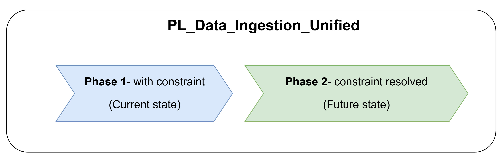

# Execution Plan for PL_Data_Ingestion

## Migration at a Glance: Two Phases



## Table of Contents

- [Approach](#approach)
- [Constraints](#constraints)
  - [Constraint 1: Database (Not Yet Centralized)](#constraint-1-database-not-yet-centralized)
  - [Constraint 2: Storage Account Resource Group (not yet centralized)](#constraint-2-storage-account-resource-group-not-yet-centralized)
- [Selected Option: — Switch Activity](#selected-option--switch-activity)
  - [Trigger-to-Environment Mapping](#trigger-to-environment-mapping)
- [Phase 1: Actions Now (Constraints Still Open)](#phase-1-actions-now-constraints-still-open)
  - [Constraint 1 (Database) — Actions Now](#constraint-1-database--actions-now)
  - [Constraint 2 (Storage Account) — Actions Now](#constraint-2-storage-account--actions-now)
- [Phase 2: Actions Once Constraints Are Addressed](#phase-2-actions-once-constraints-are-addressed)
  - [Constraint 1 (Database) — Actions Once Schema Is Ready](#constraint-1-database--actions-once-schema-is-ready)
  - [Constraint 2 (Storage Account) — Actions Once Storage Is Centralized](#constraint-2-storage-account--actions-once-storage-is-centralized)
- [Cutover: Old Trigger → New Trigger](#cutover-old-trigger--new-trigger)
  - [Rollback Plan](#rollback-plan)
- [Implementation Status (2026-08-05)](#implementation-status-2026-08-05)
  - [Completed Components](#completed-components)
  - [Current Deployment Strategy](#current-deployment-strategy)
- [Pending for Future](#pending-for-future)
- [Related Files](#related-files)

---

## Approach

We parallel-develop `PL_Data_Ingestion_Unified` and its dependencies (datasets, linked services, triggers) alongside the existing, actively-used `PL_Data_Ingestion` pipeline — with **no impact on the existing production run**.

Once the unified pipeline and its dependencies are deployed and validated, we cut over by switching the trigger binding from **old → new**, so that new events fire `PL_Data_Ingestion_Unified` instead of the original pipeline. The old pipeline and trigger are kept disabled (not deleted) so we can roll back instantly if needed.

```
Step 1: Parallel Build          Step 2: Deploy            Step 3: Cutover
─────────────────────           ───────────               ────────────────
PL_Data_Ingestion (old)   ──►   Both pipelines   ──►   Old trigger: Disabled
   + old trigger  (active)      exist in ADF           New trigger: Enabled
                                 old trigger            └─► fires PL_Data_Ingestion_Unified
PL_Data_Ingestion_Unified        still active
   + new trigger  (inactive,
     built alongside)
```

---

## Constraints

Two constraints must be tracked separately because of the migration timeline.

### Constraint 1: Database (Not Yet Centralized)

The database is still different per environment, so the centralized pipeline must, for now, point to different environment-specific databases. Later, once there is a single centralized database, no parameterization will be needed at all.

```
CURRENT                                          FUTURE
────────────────────────────────                 ────────────────────────────────
PL_Data_Ingestion_Unified                        PL_Data_Ingestion_Unified
        │                                                │
        ▼                                                ▼
LS_DMAP_SQL_{ENV}                                LS_DMAP_SQL_Unified (parameterized)
   (LS_DMAP_SQL_DEV, LS_DMAP_SQL_TST,               @concat('...dmap-', Environment, '...')
    LS_DMAP_SQL_ACC, LS_DMAP_SQL_PRD)
        │                                                │
        ▼                                                ▼
resolved via Switch(Environment):                resolves per run:
   dev / tst / sbdev / acc / prd                     dev / tst / sbdev / acc / prd
   → matching env-specific database                  database automatically
```

| Environment | Target Database |
|-------------|----------------|
| SBDEV | `msc-ssr-dmap-sbdev.database.windows.net` |
| TST | `msc-ssr-dmap-tst.database.windows.net` |
| DEV | `msc-ssr-dmap-dev.database.windows.net` |
| ACC | `msc-ssr-dmap-acc.database.windows.net` |
| PRD | `msc-ssr-dmap-prd.database.windows.net` |

### Constraint 2: Storage Account Resource Group (Not Yet Centralized)

The storage account and data lake used by `PL_Data_Ingestion` currently live in a **different resource group** from the centralized infrastructure. In the coming weeks they will be moved to the **centralized PRD resource group**.

```
CURRENT                                          FUTURE
────────────────────────────────                 ────────────────────────────────
Storage Account / Data Lake                      Storage Account / Data Lake
   in separate resource group                       in centralized PRD resource group
   (e.g. MSC-RSG-DMAPSB-DEV)                         (e.g. MSC-RSG-DMAP-PRD)
        │                                                │
        ▼                                                ▼
Trigger.scope = literal resourceId               Trigger.scope = updated resourceId
   pointing at OLD resource group                   pointing at NEW resource group
        │                                                │
        ▼                                                ▼
Event Grid subscription valid,                   Event Grid subscription must be
   trigger fires normally                            re-created against new resourceId
                                                     (old subscription breaks on move)
```

**Impact on Triggers:**
- Triggers are directly bound to the storage account via Event Grid subscription (`typeProperties.scope`)
- The trigger's `scope` property contains a **literal resourceId** that includes the resource group path
- When the storage account moves, the resourceId changes and **existing triggers stop working** until `scope` is updated and the subscription is re-created

---

## Selected Option: — Switch Activity

Modify `PL_Data_Ingestion_Unified` to use a Switch activity before the lookup, routing to the correct environment-specific database dataset based on the `Environment` parameter:

```json
{
    "name": "Switch on Environment",
    "type": "Switch",
    "typeProperties": {
        "on": {
            "value": "@toUpper(pipeline().parameters.Environment)",
            "type": "Expression"
        },
        "cases": [
            {
                "value": "DEV",
                "activities": [/* Lookup using LS_Database_DEV */]
            },
            {
                "value": "TST", 
                "activities": [/* Lookup using LS_Database_TST */]
            },
            {
                "value": "ACC",
                "activities": [/* Lookup using LS_Database_ACC */]
            },
            {
                "value": "PRD",
                "activities": [/* Lookup using LS_Database_PRD */]
            }
        ],
        "defaultActivities": [/* Lookup using LS_Database_DEV */]
    }
}
```

### Trigger-to-Environment Mapping

| Trigger Suffix | Environment Parameter | Target Database |
|---------------|----------------------|-----------------|
| `_DEV` | `dev` | `msc-ssr-dmap-dev.database.windows.net` |
| `_TST` | `tst` | `msc-ssr-dmap-tst.database.windows.net` |
| `_SBDEV` | `sbdev` | `msc-ssr-dmap-sbdev.database.windows.net` |
| `_ACC` | `acc` | `msc-ssr-dmap-acc.database.windows.net` |
| (no suffix / PRD) | `prd` | `msc-ssr-dmap-prd.database.windows.net` |

---

## Phase 1: Actions Now (Constraints Still Open)

### Constraint 1 (Database) — Actions Now

1. **Create Environment-Specific Linked Services**
   - Create `LS_DMAP_SQL_DEV`, `LS_DMAP_SQL_TST`, `LS_DMAP_SQL_ACC`, `LS_DMAP_SQL_PRD`
   - Each with correct, hardcoded database connection string
2. **Create Environment-Specific Datasets**
   - Create `LS_Database_DEV`, `LS_Database_TST`, `LS_Database_ACC`, `LS_Database_PRD`
   - Each referencing its corresponding linked service
3. **Modify Pipeline**
   - Add the Switch activity (Option A) to `PL_Data_Ingestion_Unified` to route to the correct dataset per `Environment`

### Constraint 2 (Storage Account) — Actions Now

1. **Build in parallel, do not touch production**
   - Develop `PL_Data_Ingestion_Unified` and its datasets/linked services against the storage account in its **current** resource group location
   - Do not modify the existing `PL_Data_Ingestion` pipeline or its trigger
2. **Update new triggers only**
   - Add the `Environment` parameter to the new environment-specific triggers (`_TST`, `_SBDEV`) that will point at `PL_Data_Ingestion_Unified`
   - Leave `scope` pointing at the current resource group — it is still valid at this point
3. **Deploy and validate**
   - Deploy `PL_Data_Ingestion_Unified` alongside the existing pipeline
   - Test end-to-end with current storage account location before doing any cutover

---

## Phase 2: Actions Once Constraints Are Addressed

### Constraint 1 (Database) — Actions Once Schema Is Ready

1. **Switch to Parameterized Linked Service** (`LS_DMAP_SQL_Unified`):
   ```json
   {
       "typeProperties": {
           "connectionString": {
               "value": "@concat('Data Source=msc-ssr-dmap-', pipeline().parameters.Environment, '.database.windows.net;Initial Catalog=DMAP;...')",
               "type": "Expression"
           }
       }
   }
   ```
2. **Point to a Single Unified Dataset** (`LS_Database_Unified`) — no environment-specific datasets needed
3. **Cleanup**:
   - Remove environment-specific datasets and linked services
   - Remove the Switch activity from the pipeline

### Constraint 2 (Storage Account) — Actions Once Storage Is Centralized

1. **Update trigger `scope`** on every trigger to the new centralized PRD resource group resourceId:

   **Current (example):**
   ```json
   "scope": "/subscriptions/{sub}/resourceGroups/MSC-RSG-DMAPSB-DEV/providers/Microsoft.Storage/storageAccounts/mscstadmapsbdev"
   ```

   **After Centralization (example):**
   ```json
   "scope": "/subscriptions/{sub}/resourceGroups/MSC-RSG-DMAP-PRD/providers/Microsoft.Storage/storageAccounts/mscstadmapsbdev"
   ```
2. **Re-create Event Grid subscriptions** — Azure removes the old subscription automatically when the storage account is moved, so a new subscription must be created against the new resourceId
3. **Validate trigger firing** — confirm `BlobCreated` events reach ADF after the move
4. **Update linked service endpoints** if the storage account URL/naming changes as part of centralization

> **Important:** Disable affected triggers before the storage account move, then re-enable them (with updated `scope`) once the new Event Grid subscription is confirmed working.

---

## Cutover: Old Trigger → New Trigger

Once both constraints are addressed (or accepted as-is for the interim per Phase 1) and `PL_Data_Ingestion_Unified` has been validated:

1. Disable the old trigger (e.g., `Event_STA_CHK_FIX_*`) bound to `PL_Data_Ingestion`
2. Enable the new environment-specific trigger (e.g., `Event_STA_CHK_FIX_*_TST`) bound to `PL_Data_Ingestion_Unified`
3. New blob events now fire `PL_Data_Ingestion_Unified` instead of the old pipeline

### Rollback Plan

If issues occur after cutover:
1. Disable the environment-specific trigger (e.g., `Event_STA_CHK_FIX_*_TST`)
2. Enable the original trigger (e.g., `Event_STA_CHK_FIX_*`)
3. `PL_Data_Ingestion` will then get triggered automatically

---

## Implementation Status (2026-08-05)

### Completed Components

#### 1. Environment-Specific Linked Services (Created)
| File | Database Connection |
|------|---------------------|
| `LS_DMAP_SQL_TST.json` | `msc-ssr-dmap-tst.database.windows.net` |
| `LS_DMAP_SQL_SBDEV.json` | `msc-ssr-dmap-sbdev.database.windows.net` |

#### 2. Environment-Specific Datasets (Created)
| File | Linked Service Reference |
|------|--------------------------|
| `LS_Database_TST.json` | `LS_DMAP_SQL_TST` |
| `LS_Database_SBDEV.json` | `LS_DMAP_SQL_SBDEV` |

#### 3. Pipeline Modification (Implemented)
`PL_Data_Ingestion_Unified.json` now includes:
- **Switch Activity**: `Switch on Environment for Lookup`
  - Routes to environment-specific dataset based on `Environment` parameter
  - Cases: `tst` → `LS_Database_TST`, `sbdev` → `LS_Database_SBDEV`
  - Default: `LS_Database_Unified` (for future unified database)
- **Variable**: `FoldermappingResult` stores lookup results for downstream activities

#### 4. Triggers Updated
| Trigger Type | Environment Parameter | Status |
|--------------|----------------------|--------|
| `*_TST.json` (35 triggers) | `"Environment": "tst"` | ✅ Updated |
| `*_SBDEV.json` (35 triggers) | `"Environment": "sbdev"` | ✅ Updated |
| `*_DEV.json` | - | ❌ Deleted (except FolderMapping trigger) |

### Current Deployment Strategy

```
                    ┌─────────────────────────────────────┐
                    │     PL_Data_Ingestion_Unified       │
                    │                                     │
    _TST triggers ──┼──► Switch(Environment) ──► tst ──► LS_Database_TST
                    │                        │          (LS_DMAP_SQL_TST)
  _SBDEV triggers ──┼────────────────────────┼► sbdev ► LS_Database_SBDEV
                    │                        │          (LS_DMAP_SQL_SBDEV)
                    │                        │
                    │                        └► default► LS_Database_Unified
                    │                                    (future: parameterized)
                    └─────────────────────────────────────┘
```

---

## Pending for Future
- [ ] Database schema update for parameterized connection
- [ ] Create `LS_DMAP_SQL_ACC` and `LS_Database_ACC` for ACC environment
- [ ] Create `LS_DMAP_SQL_PRD` and `LS_Database_PRD` for PRD environment
- [ ] Update `LS_DMAP_SQL_Unified` to use parameterized connection string
- [ ] Remove Switch activity and environment-specific components once unified is ready
- [ ] Update trigger `scope` and re-create Event Grid subscriptions once storage account is centralized

---

## Related Files

- Pipeline: [PL_Data_Ingestion_Unified.json](../../../DataFactory/pipeline/PL_Data_Ingestion_Unified.json)
- Dataset: [LS_Database_Unified.json](../../../DataFactory/dataset/LS_Database_Unified.json)
- Linked Service: [LS_DMAP_SQL_Unified.json](../../../DataFactory/linkedService/LS_DMAP_SQL_Unified.json)
- Dataset (TST): [LS_Database_TST.json](../../../DataFactory/dataset/LS_Database_TST.json)
- Dataset (SBDEV): [LS_Database_SBDEV.json](../../../DataFactory/dataset/LS_Database_SBDEV.json)
- Linked Service (TST): [LS_DMAP_SQL_TST.json](../../../DataFactory/linkedService/LS_DMAP_SQL_TST.json)
- Linked Service (SBDEV): [LS_DMAP_SQL_SBDEV.json](../../../DataFactory/linkedService/LS_DMAP_SQL_SBDEV.json)

---

## Go / No-Go

| SB | DEV | TST | ACC | PRD |
|----|-----|-----|-----|-----|
| ✅ Go | ✅ Go (approved 2026-08-06) | ⏳ No-Go (pending) | ⏳ No-Go (pending) | ⏳ No-Go (pending) |

> **2026-08-06:** Team approved Go from SB → DEV.

### Additional Testing Identified in Go/No-Go Meeting

1. **Multi-environment single-ADF run** — test running SB and DEV concurrently from the same ADF instance
2. **Performance testing**
3. **Apartment (consumer) testing**


