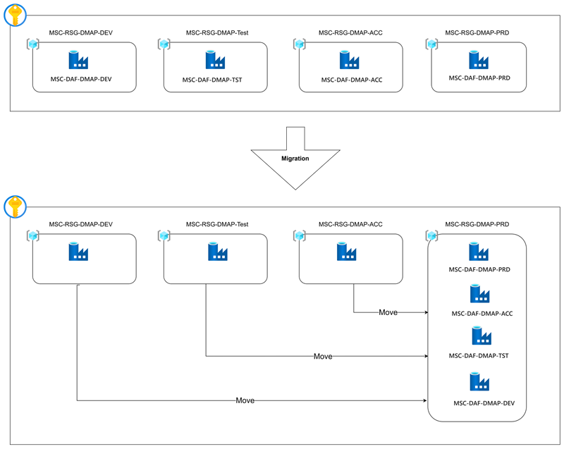

# Execution Plan: ADF Move (DEV / TEST / ACC)

## Table of Contents

- [Architecture](#architecture)
- [Overview](#overview)
- [Prerequisites](#prerequisites)
- [Migration Run Steps](#migration-run-steps)
- [Move Sequence](#move-sequence)
- [Testing in Scope](#testing-in-scope)
- [Risk](#risk)
- [RBAC Considerations](#rbac-considerations)
- [Support](#support)
- [Next Steps (Post-Move)](#next-steps-post-move)
- [Future Stage: Database and Datalake Migration Dependency](#future-stage-database-and-datalake-migration-dependency)
- [Lessons Learnt](#lessons-learnt)
- [Executed Tests](#executed-tests)
- [Go/No-Go Review Meeting](#gono-go-review-meeting)
- [Related Files](#related-files)

---

## Architecture

All ADF instances (DEV, TEST, ACC, PRD) are consolidated under the `MSC-RSG-DMAP-PRD` resource group, moving out of their respective per-environment resource groups (`MSC-RSG-DMAP-DEV`, `MSC-RSG-DMAP-Test`, `MSC-RSG-DMAP-ACC`).

## Overview

This plan covers moving the Azure Data Factory (ADF) instance to its target resource group across three environments — **DEV**, **TEST**, and **ACC** — using the automated `Move-ADF.ps1` pipeline.

As part of each move:
- Running triggers are stopped before the move and restarted afterwards.
- RBAC role assignments (resource-scoped and identity-scoped) are captured and recreated against the new scope.
- An audit log (CSV files) is generated for every run, including dry runs.

**Pipeline used for the move:** [Pipelines - Runs for ADF-MOVE](https://dllgroup.visualstudio.com/DLLGroup/_build?definitionId=4372)

---

## Prerequisites

- **Access:** `VSTSRM-MSC-RSG-DMAP-TST` requires access to the `MSC-RSG-DMAP-PRD` resource group.
- **Access:** `VSTSRM-MSC-RSG-DMAP-DEV` requires access to the `MSC-RSG-DMAP-PRD` resource group.
- **Access:** `VSTSRM-MSC-RSG-DMAP-ACC` requires access to the `MSC-RSG-DMAP-PRD` resource group.
- Make sure none of the pipelines are in a running state before you start running the move pipeline.
- No release is planned during the migration windows.

---

## Migration Run Steps

1. **Manual Move Validation** — perform a manual validation of the move steps before running the pipeline.
2. **Test the Connected Services** — verify connected services and take a screenshot of the trigger state (running/stopped) for reference.
3. **Test a trigger manually** — by manually adding a file to the storage account and confirming the trigger fires as expected.
4. **Run the Move Pipeline** — execute the `Move-ADF.ps1` pipeline for the environment. [Pipelines - Runs for ADF-MOVE](https://dllgroup.visualstudio.com/DLLGroup/_build?definitionId=4372)
5. **Test the Linked Services connectivity** — confirm all linked services are active and can connect successfully post-move.
6. **Test the trigger run** — confirm triggers fire correctly and pipelines run end-to-end post-move.

Once everything looks good, inform Marvin to communicate with the stakeholders.

---

## Move Sequence

| Order | Environment | Notes |
|-------|-------------|-------|
| 1 | TEST | First validation of the process |
| 2 | DEV | Re-validate after TEST learnings before touching ACC |
| 3 | ACC | Final environment, executed only after TEST and DEV succeed |

For each environment:
1. Run the pipeline with **Dry Run** enabled first and review the generated audit logs.
2. Confirm the dry-run output (RBAC assignments, running triggers) matches expectations.
3. Re-run the pipeline with **Dry Run** disabled to perform the actual move.
4. Verify triggers restart successfully and review the post-move audit logs.

---

## Testing in Scope

1. **Linked service connectivity** — check that all linked services are active and can connect successfully after the move.
2. **Trigger test** — confirm triggers fire correctly and pipelines run end-to-end post-move.

---

## Risk

- Test coverage may not catch every functionality break — there could be hidden/undocumented connections to the ADF instance that aren't exercised by the linked service and trigger tests above.

---

## RBAC Considerations

- Subscription-level RBAC role assignments are out of scope for this move — the pipeline does not touch or recreate any role assignments scoped at the subscription level.
- Role assignments scoped directly to the ADF resource (and to the source resource group, for the ADF managed identity) are explicitly captured and recreated by the pipeline — these are not relying on inheritance and are verified via the audit logs.
- **RBAC analysis reference:** [ADF-RBAC-Connected-Resources-Inventory.xlsx](https://connect2dll.sharepoint.com/:x:/r/sites/DMAPWiki-DMAPCollaboration/_layouts/15/Doc.aspx?sourcedoc=%7BB3FE6BB6-EA81-4972-95CF-9C5D2EF3E908%7D&file=ADF-RBAC-Connected-Resources-Inventory.xlsx&action=default&mobileredirect=true)

---

## Support

- **Support window:** A 4-hour support window is required to cover the move and any follow-up issues per environment move.
- **Stakeholder communication:** All stakeholders must be informed of the scheduled time window in advance of each move.
- **Support coverage:** Identify who from DLL can provide support during the operation window (on-call contact(s) to be named per move).

---

## Next Steps (Post-Move)

- Inform Marvin to communicate the move completion to the stakeholders.

---

## Future Stage: Database and Datalake Migration Dependency

This is out of scope for the current ADF move but must be tracked as a follow-on activity once the database and datalake migrations complete:

- Once the database migration and datalake move are complete, the ADF pipelines must be updated to reflect the new database/datalake connections.
- Triggers must only be re-initiated after the datalake move is confirmed complete.

---

## Lessons Learnt

*(To be updated after the first move.)*

---

## Executed Tests

**Resource used for the test:** [MSC-DAF-DMAPSB-DEV-MIG01](https://portal.azure.com/#@dllgroup.com/resource/subscriptions/c47bfe3d-881a-4142-bf65-ec835858a67b/resourceGroups/MSC-RSG-DMAPSB-DEV/providers/Microsoft.DataFactory/factories/MSC-DAF-DMAPSB-DEV-MIG01/overview)

| # | Test | Run |
|---|------|-----|
| 1 | Move ADF from `MSC-RSG-DMAPSB-DEV` to `MSC-RSG-DMAPSB-TRACC` | [Pipelines - Run 20260828.2](https://dllgroup.visualstudio.com/DLLGroup/_build/results?buildId=1417845&view=results) |
| 2 | Move ADF back from `MSC-RSG-DMAPSB-TRACC` to `MSC-RSG-DMAPSB-DEV` | [Pipelines - Run 20260828.3 logs](https://dllgroup.visualstudio.com/DLLGroup/_build/results?buildId=1417891&view=logs&j=3777a3ed-267b-5db0-a9f6-ba1c280bbb92&t=78db2542-c627-4140-8a7a-d06178fff4e4) |
| 3 | Verified running trigger state and stopped trigger state | — |

### Rehearsal — 2026-08-31

**Resource used for the test:** [MSC-DAF-DMAPSB-DEV](https://portal.azure.com/?feature.msaljs=true#@dllgroup.com/resource/subscriptions/c47bfe3d-881a-4142-bf65-ec835858a67b/resourceGroups/MSC-RSG-DMAPSB-TRACC/providers/Microsoft.DataFactory/factories/MSC-DAF-DMAPSB-DEV/overview)

| # | Test | Result |
|---|------|--------|
| 1 | ADF move pipleine run successful, took 25 minutes | [Pipelines - Run 20260831.2 logs](https://dllgroup.visualstudio.com/DLLGroup/_build/results?buildId=1419811&view=logs&j=3777a3ed-267b-5db0-a9f6-ba1c280bbb92&t=90cceac6-926c-5a5b-c37a-ec5794bfe598) |
| 2 | Linked services test after the move | Successful |
| 3 | Manually uploaded `DMAP_TEST` with a `.CHK` file, both before and after the move | Trigger fired and copied the file from the landing zone to the data lake in both cases |
| 4 | Pipeline run check — 38 triggers in running state | [Pipelines - Run 20260831.2 logs](https://dllgroup.visualstudio.com/DLLGroup/_build/results?buildId=1419811&view=logs&j=3777a3ed-267b-5db0-a9f6-ba1c280bbb92&t=90cceac6-926c-5a5b-c37a-ec5794bfe598) |

---

## Go/No-Go Review Meeting

A Go/No-Go review meeting is held with the team before each environment move, following the [Move Sequence](#move-sequence) order: TEST first, then DEV, then ACC.

| Environment | Move | Go/No-Go Decision | Date |
|-------------|------|--------------------|------|
| TEST | TST → PRD | Go | 31 August 2026 |
| DEV | DEV → PRD | Go | 03 September 2026 |
| ACC | ACC → PRD | Go | 07 September 2026 |

---

## Related Files

- [Move-ADF.ps1](./Move-ADF.ps1)
- [azure-pipelines.yaml](./azure-pipelines.yaml)
- [README.md](./README.md)
