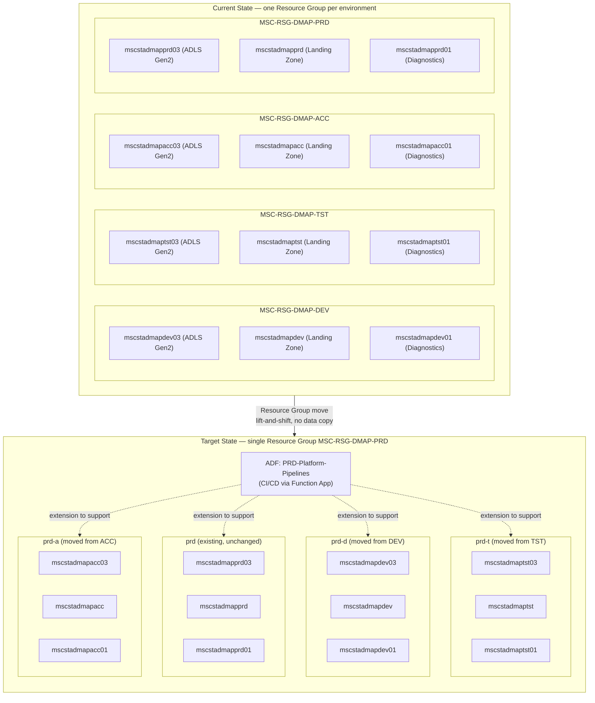

This project is a platform consolidation: existing Dev, Test, and Acceptance Azure Data Lake Storage accounts will be moved (resource-group move / lift-and-shift) into the Production Resource Group. This is not a data copy or storage consolidation; storage accounts, names, endpoints and URLs will remain unchanged and continue to serve their respective environments.

Key characteristics
Existing Storage Accounts are retained; only their Resource Group changes.
Storage account names, endpoints and URLs remain unchanged.
No data copy or storage migration is required.
Dev, Test, Acceptance and Production remain separate logical environments.

---

## Current State

Each environment currently has its own Resource Group, each containing 3 storage accounts:

| Resource Group | Storage Account | Purpose |
|---|---|---|
| `MSC-RSG-DMAP-DEV` | `mscstadmapdev03` | ADLS Gen2 |
| `MSC-RSG-DMAP-DEV` | `mscstadmapdev` | Landing Zone |
| `MSC-RSG-DMAP-DEV` | `mscstadmapdev01` | Diagnostics |
| `MSC-RSG-DMAP-TST` | `mscstadmaptst03` | ADLS Gen2 |
| `MSC-RSG-DMAP-TST` | `mscstadmaptst` | Landing Zone |
| `MSC-RSG-DMAP-TST` | `mscstadmaptst01` | Diagnostics |
| `MSC-RSG-DMAP-ACC` | `mscstadmapacc03` | ADLS Gen2 |
| `MSC-RSG-DMAP-ACC` | `mscstadmapacc` | Landing Zone |
| `MSC-RSG-DMAP-ACC` | `mscstadmapacc01` | Diagnostics |

Production already exists as its own Resource Group (`MSC-RSG-DMAP-PRD`) with its own 3 storage accounts (`mscstadmapprd03`, `mscstadmapprd`, `mscstadmapprd01`) and is **not** moved — it stays where it is and becomes the consolidation target.

## Target State

All Dev, Test and Acceptance storage accounts are moved (Azure resource move, RG-to-RG) into the single Production Resource Group `MSC-RSG-DMAP-PRD`, alongside the existing Production storage accounts. Inside the target RG, the accounts are logically grouped by their original environment (`prd`, `prd-d`, `prd-t`, `prd-a`), but each storage account keeps its original name, endpoint and URL — only its owning Resource Group changes.

| Logical group (in `MSC-RSG-DMAP-PRD`) | Storage Accounts | Source RG (moved from) |
|---|---|---|
| `prd` (existing, unchanged) | `mscstadmapprd03`, `mscstadmapprd`, `mscstadmapprd01` | `MSC-RSG-DMAP-PRD` (no move) |
| `prd-d` | `mscstadmapdev03`, `mscstadmapdev`, `mscstadmapdev01` | `MSC-RSG-DMAP-DEV` |
| `prd-t` | `mscstadmaptst03`, `mscstadmaptst`, `mscstadmaptst01` | `MSC-RSG-DMAP-TST` |
| `prd-a` | `mscstadmapacc03`, `mscstadmapacc`, `mscstadmapacc01` | `MSC-RSG-DMAP-ACC` |

After the move, ADF (via the `PRD-Platform-Pipelines` CI/CD Function App) is extended to support all four logical groups within the single target Resource Group, rather than each environment having its own Resource Group with its own pipeline/CI-CD footprint.

## Storage Account Roles (per environment)

Each environment consistently has 3 storage accounts, each with a distinct role that is preserved after the move:

- **`03` suffix — ADLS Gen2**: hierarchical namespace-enabled Data Lake storage for the raw/curated data layer.
- **no numeric suffix — Landing Zone**: blob storage account where source files land and BlobEvents triggers fire from (see `PL_Data_Ingestion` trigger).
- **`01` suffix — Diagnostics**: storage account used for diagnostic logs / monitoring data.

## Dependencies

- ADF (`PRD-Platform-Pipelines`) and its CI/CD Function App must be extended to resolve/support all four logical groups (`prd`, `prd-d`, `prd-t`, `prd-a`) from the single `MSC-RSG-DMAP-PRD` Resource Group.
- Any RBAC role assignments, resource locks, diagnostic settings, or Private Endpoints scoped to the *Resource Group* (rather than the storage account) must be re-created in `MSC-RSG-DMAP-PRD` post-move, since RG-scoped assignments do not travel with a resource move.
- BlobEvents triggers (Event Grid subscriptions) reference storage accounts by resource ID; resource IDs change RG segment after the move, so trigger `scope` values must be updated to the new resource path (see [ADF Parameterization POC](../../06-POCs/ADF-Parameterization/poc-adf-context.md)).
- CI/CD pipeline definitions/variables that hard-code the source Resource Group name per environment need to be updated to point at `MSC-RSG-DMAP-PRD`.

## Risks & Considerations

- **Resource move limitations**: not all Azure resource types support RG-to-RG move (e.g. resources with active Private Endpoints, certain locks, or resources referenced by Azure Policy scoped to the old RG) — validate move eligibility per storage account before executing.
- **Downtime**: resource moves briefly affect resource availability/management operations during the move; data-plane access (blob read/write) is typically unaffected, but this must be validated per environment.
- **Naming collisions**: since Dev/Test/Acc/Prd storage account names are all landing in one RG, confirm no naming or tagging conflicts exist within `MSC-RSG-DMAP-PRD`.
- **Access control drift**: RG-scoped RBAC, diagnostic settings, and locks do not move automatically and must be manually reconciled to avoid unintended access changes.
- **Reference updates**: any hard-coded Resource Group names in ARM/Bicep, ADF triggers, CI/CD variables, or documentation must be identified and updated — see [Dependency.md](Dependency.md) for the full dependency inventory.
