# DMAP Database Migration

This document is the umbrella reference for the DMAP migration approach. It is intended for
client presentation and will grow over time as additional migration strategies are added; each
strategy gets its own top-level section below.

**Summary:** Two synchronization directions are covered. **Strategy 1 (Load to Production)**
loads data from each lower environment (Dev/Tst/Acc) up into Production, using two load
strategies — **Load to Staging** (copy source data into a staging table) followed by
**Validate & Load** (validate against business keys, then apply `SKIP_EXISTING`/`UPSERT`/
`INSERT_IF_NOT_EXISTS` into Production). **Strategy 2 (Production to Lower Environment Synchronization)** flows the other
way, syncing data from Production down into each lower environment via **UPSERT**, either scoped
to that environment's records (environment-specific tables) or across all records
(non-environment-specific tables).

**Decision Logic (Load into Production):**

1. **Load to Staging**
   - Copy the source data from the selected lower environment into the corresponding **Production staging table**.
   - The staging layer acts as an intermediate area where the data can be checked before it is applied to Production.
2. **Validate & Load**
   - Validate the staged data against the defined **business keys** and applicable validation rules.
   - After successful validation, apply the data to the Production table using the selected load strategy:
     - `SKIP_EXISTING` – insert only records that do not already exist in Production.
     - `UPSERT` – update existing records and insert new records.
     - `INSERT_IF_NOT_EXISTS` – insert only records that do not already exist in Production; if a record's business key already exists but its other values differ from staging, fail the validation/load instead of updating it.

**Mermaid: Load into Production decision flow (high-level)**

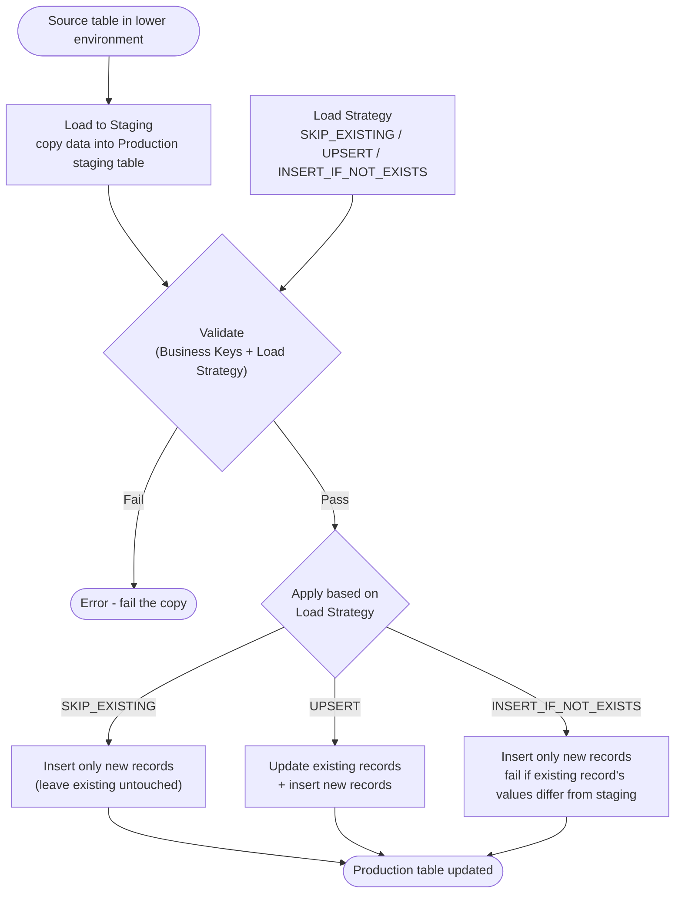

**Decision Logic (Synchronize Production into lower environment):**

1. **Environment-Specific Table**
   - If the table is identified as **environment-specific**, synchronize only the relevant records/data for that lower environment.
   - Use **UPSERT** to synchronize the data:
     - Update existing records based on the defined business/primary key.
     - Insert records that do not exist in the lower environment.
2. **Non-Environment-Specific Table**
   - If the table is **not environment-specific**, synchronize **all records** from Production to the lower environment.
   - Use **UPSERT** to synchronize the data:
     - Update existing records.
     - Insert new records.

## Table of Contents

- [Strategy 1: Load to Production](#strategy-1-load-to-production)
  - [1. Overview](#1-overview)
  - [2. Load to Staging + Validate \& Load to Production (design)](#2-load-to-staging--validate--load-to-production-design)
  - [3. Automation (ADF pipeline chain)](#3-automation-adf-pipeline-chain)
  - [4. Mermaid: end-to-end pipeline flow](#4-mermaid-end-to-end-pipeline-flow)
  - [5. Where results are recorded](#5-where-results-are-recorded)
  - [6. Open items / next iterations](#6-open-items--next-iterations)
- [Strategy 2: Production to Lower Environment Synchronization](#strategy-2-production-to-lower-environment-synchronization)
  - [1. Overview](#1-overview-1)
  - [2. Decision: how a table is synchronized](#2-decision-how-a-table-is-synchronized)
  - [3. Mermaid: sync decision flow](#3-mermaid-sync-decision-flow)
- [Open Question: Access & Deployment Approach for Database Migration Automation](#open-question-access--deployment-approach-for-database-migration-automation)
- [Open Points from Demo](#open-points-from-demo)
- [Onboarding a New Table to the Load and Sync Strategy](#onboarding-a-new-table-to-the-load-and-sync-strategy)
- [First Candidate Table: `CI_AIC` Migration](#first-candidate-table-ci_aic-migration)
- [Migration Window](#migration-window)

---

## Strategy 1: Load to Production

This strategy describes the end-to-end execution flow for migrating data from the source
environments (Dev/tst/Acc) into Production, via a Staging layer, with validation gating the
Production load.

### 1. Overview

The migration runs in two phases, orchestrated by a single master pipeline:

1. **Load to Staging** — copies each configured source table (Dev/tst/Acc) into a staging table
   on the Prd server (`mig_stg_<env>.<Schema>_<TableName>`).
2. **Validate & Load to Production** — validates each staging table against configured business
   keys, then applies the configured Load Strategy (e.g. `SKIP_EXISTING`, `UPSERT`) to move data
   from staging into the real Production table (`<Schema>.<TableName>`).

Both phases are metadata-driven: which tables to process, and how to load them, comes from SQL
metadata tables rather than being hardcoded in the pipelines.

### 2. Load to Staging + Validate & Load to Production (design)

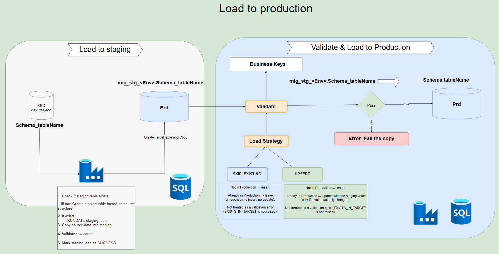

**Load to Staging:**
1. Check if the staging table exists; if not, create it based on the source table's structure.
2. If it exists, `TRUNCATE` it.
3. Copy source data into staging.
4. Validate row count.
5. Mark the staging load as `SUCCESS`.

**Validate & Load to Production**, per table, driven by **Business Keys** and **Load Strategy**:

| Load Strategy | Not in Production | Already in Production |
|---|---|---|
| `SKIP_EXISTING` | Insert | Leave untouched (no insert, no update). Not treated as a validation error. |
| `UPSERT` | Insert | Update with the staging value, only if a value actually changed. Not treated as a validation error. |
| `INSERT_IF_NOT_EXISTS` | Insert | Leave untouched if the staging values already match (no-op, not an error). Fail validation/load (`BUSINESS_KEY_VALUE_MISMATCH`) if the staging values differ. |

If validation fails (`Pass = No`), the load is stopped with an error and the copy to Production is
not performed.

### 3. Automation (ADF pipeline chain)

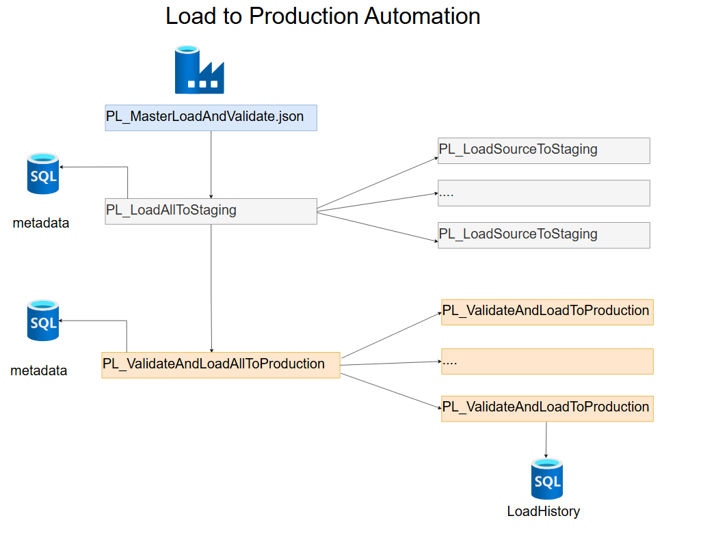

A single master pipeline (`PL_MasterLoadAndValidate.json`) triggers both phases in order:

1. `PL_LoadAllToStaging` — reads its metadata table and fans out to one `PL_LoadSourceToStaging`
   run per configured table.
2. `PL_ValidateAndLoadAllToProduction` — reads its metadata table and fans out to one
   `PL_ValidateAndLoadToProduction` run per configured table, writing every execution's outcome to
   a `LoadHistory` (audit) table.

### Initial Testing

All three Load Strategies (`SKIP_EXISTING`, `UPSERT`, `INSERT_IF_NOT_EXISTS`) have been tested,
including negative testing, and are working as expected:

1. **`SKIP_EXISTING`** — new records are inserted; existing records are left untouched.
2. **`UPSERT`** — new records are inserted; existing records are updated only when a value
   actually changed.
3. **`INSERT_IF_NOT_EXISTS`** — new records are inserted; existing records with matching staging
   values are left untouched, and records whose staging values differ from Production fail
   validation (`BUSINESS_KEY_VALUE_MISMATCH`).

**Negative test** — when validation fails (e.g. `INSERT_IF_NOT_EXISTS` with a business-key value
mismatch), the pipeline stops with an explicit error and the copy to Production is not performed:

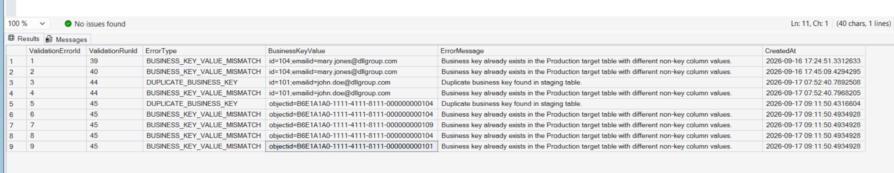

### 4. Mermaid: end-to-end pipeline flow

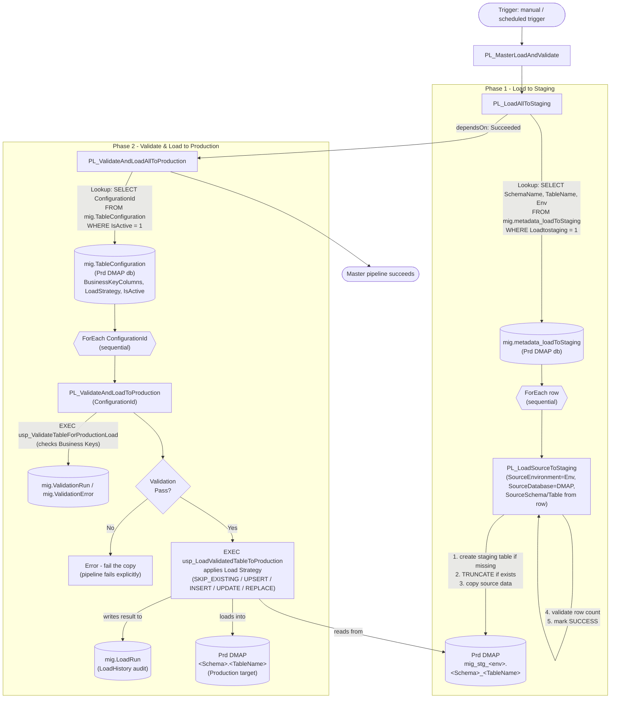

### 5. Where results are recorded

| Table | Purpose |
|---|---|
| `mig.metadata_loadToStaging` | Drives Phase 1: which source env/schema/table to stage, and whether it's enabled (`Loadtostaging`). |
| `mig.TableConfiguration` | Drives Phase 2: source/target mapping, `BusinessKeyColumns`, `LoadStrategy`, and whether it's enabled (`IsActive`). |
| `mig.ValidationRun` / `mig.ValidationError` | One row per validation execution (Pass/Fail) and per rule violation found. |
| `mig.LoadRun` | One row per Production load attempt (`LoadHistory`): status (`RUNNING`/`SUCCESS`/`ERROR`/`BLOCKED`), records read/inserted/updated/failed. |
| `mig.StagingLoadRun` | One row per `PL_LoadSourceToStaging` execution (Phase 1): status, source/staging row counts. |
| `mig.MasterRun` | One row per `PL_MasterLoadAndValidate` execution, keyed by `BatchId`. The same `BatchId` is reused as `mig.StagingLoadRun.BatchId` and `mig.ValidationRun`/`mig.LoadRun.BatchId` for that run, giving a full audit trail across both phases. |

### 6. Open items / next iterations

- [ ] Add REPLACE and INSERT/UPDATE strategy details to the client-facing table above.
- [ ] Add error-handling / retry behavior for `PL_LoadSourceToStaging` failures.
- [ ] Add screenshots of a sample `mig.LoadRun` / `mig.ValidationRun` result set.

---

## Strategy 2: Production to Lower Environment Synchronization

This strategy describes the automated approach for synchronizing data **from Production down to
the lower environments** (Dev/Tst/Acc), keeping reference/config data aligned across environments
without overwriting environment-specific data that belongs only to a given lower environment.

### 1. Overview

Each configured table is classified as either **environment-specific** or
**non-environment-specific**. This classification drives which records are synchronized; in both
cases, the mechanism used to apply the sync is **UPSERT**, keyed on the table's defined
business/primary key.

### 2. Decision: how a table is synchronized

| Table Type | Records Synchronized | Sync Method |
|---|---|---|
| **Environment-specific** | Only the records/data relevant to the target lower environment | **UPSERT** — update existing records matched on business/primary key; insert records that don't yet exist in the lower environment |
| **Non-environment-specific** | All records from Production | **UPSERT** — update existing records; insert new records |

Implementation (SQL metadata/audit tables + ADF pipelines) lives in its own
[`Synchronise/`](Synchronise/README.md) folder, kept separate from the Strategy 1 files under
`sql/` and `adf/` so the two efforts don't get mixed together.

### 3. Mermaid: sync decision flow

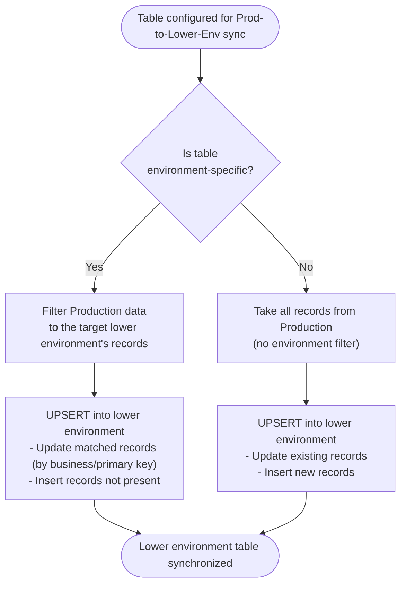

## Open Question: Access & Deployment Approach for Database Migration Automation

This automation solution consists of three components that need to be provisioned.

1. **Azure Data Factory (ADF)**
2. **Metadata tables** (e.g., `mig.TableConfiguration`, `mig.ValidationRun`, `mig.ValidationError`, `mig.LoadRun`)
3. **Stored procedures** (validation and load logic)

Before raising access requests, we'd like to confirm the following approach:

1. **ADF placement and permissions**
   - Can we use the existing **TRACC resource group** to host the ADF instance for this automation?
   - The ADF will need connectivity/access to **all relevant databases** (source, staging, and Production) via linked services, in order to read from staging and write to Production.
   - If this approach is approved, the access request will be raised accordingly.
2. **Metadata table creation in Production**
   - Can the metadata tables (schema `mig`) be created **manually** in the Production database (via the provided SQL scripts), or does this need to go through a formal deployment/change process?

## Open Points from Demo

1. ~~**New Load Strategy — `INSERT_IF_NOT_EXISTS`**: Insert the record if the business key does not already exist in the target. If the business key exists but the non-key column values don't match, fail (raise a validation/load error) rather than updating.~~ **Implemented** — see `mig.usp_ValidateTableForProductionLoad` / `mig.usp_LoadValidatedTableToProduction` and the Load Strategy table above.
2. **Trial run** on a small set of tables, to be selected by Surya and team.
3. ~~**Audit trail for the master pipeline**, linking each run to its corresponding Load-to-Staging run and Validate-and-Load-to-Production run.~~ **Implemented** — `PL_MasterLoadAndValidate` generates one `MasterBatchId`, records it in `mig.MasterRun`, and forwards it through `PL_LoadAllToStaging`/`PL_LoadSourceToStaging` (logged as `mig.StagingLoadRun.BatchId`) and `PL_ValidateAndLoadAllToProduction`/`PL_ValidateAndLoadToProduction` (reused as `mig.ValidationRun`/`mig.LoadRun.BatchId`), so every table's staging load, validation, and Production load for a given master run can be traced back to a single `mig.MasterRun` row.
4. ~~**Data quality check** after the load completes.~~ **Implemented** — `mig.usp_LoadValidatedTableToProduction` re-checks the Production target for duplicate business keys after applying the load, and rolls back / fails the `LoadRun` (`ERROR`) if any are found.
5. **Business key existence check** — verify whether the business key already exists in the target table.

# Database Data Migration Framework

1. **Target Database**

   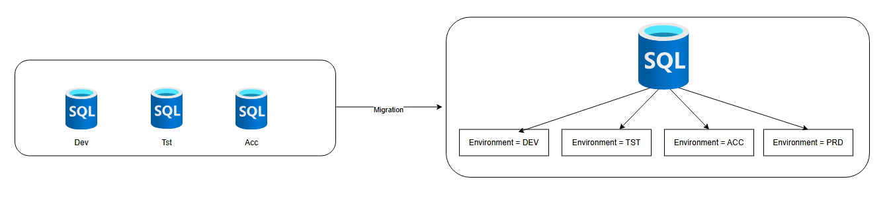

2. **Framework used for the Database Migration**

   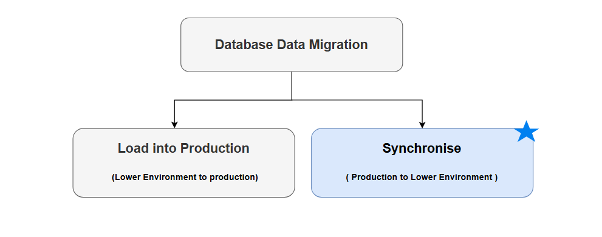

3. **Load to Production design**

   

4. **Automation**

   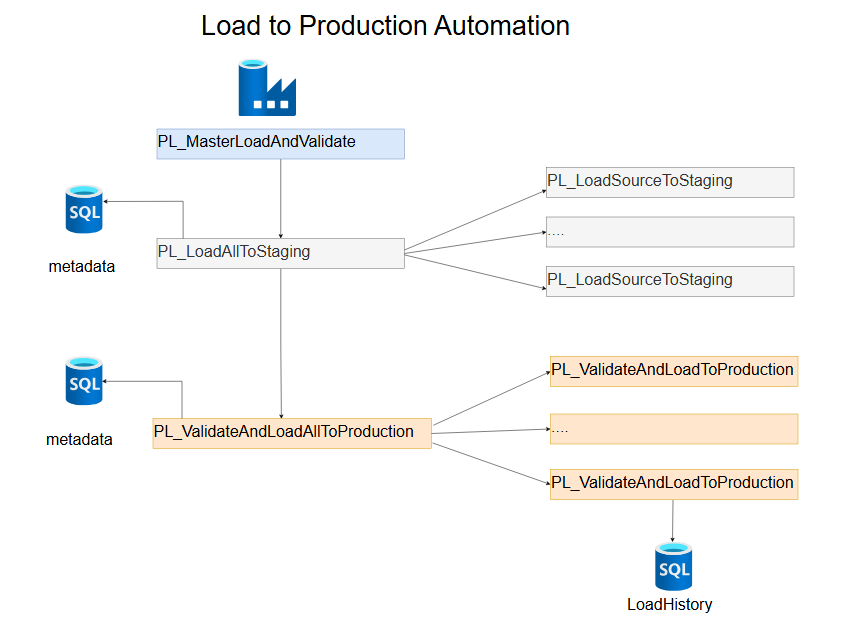

5. **Synchronization Framework**

   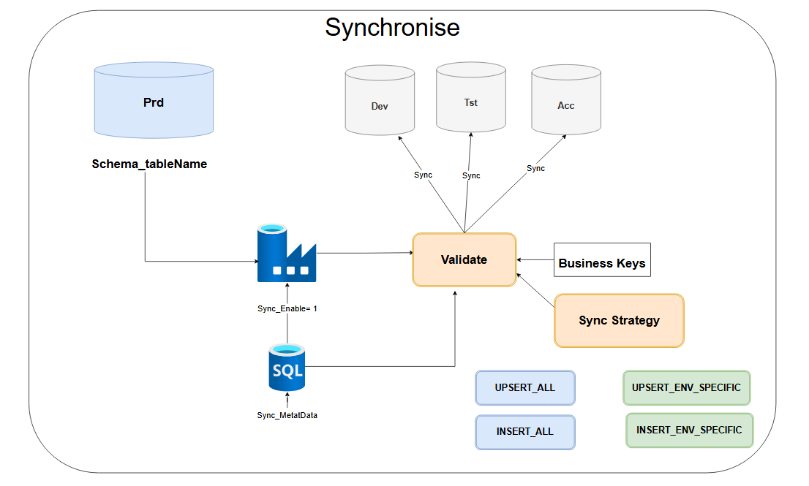

6. **Synchronization Automation**

   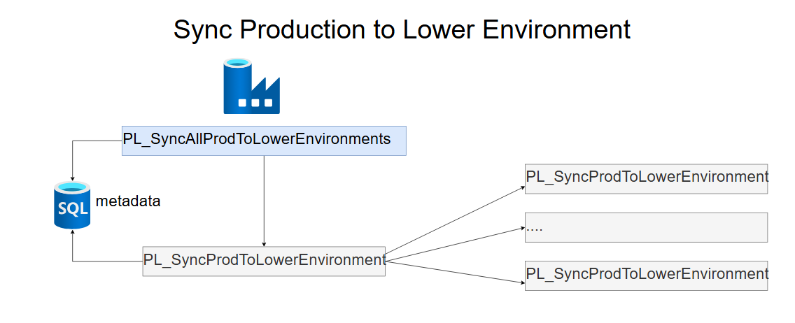

## Framework Setup

1. **Create Azure Data Factory for the Automation to run**
   - Resource Group: `MSC-RSG-DMAPSB-TRACC`
   - Name: `MSC-DAF-DMAPSB-DBMIGF`
   - 1.1. Create the Linked Services to point to Dev, Tst, Acc and Prod databases.
   - 1.2. Give access of ADF to the databases.
   - 1.3. Deploy automation pipelines.
2. **Create the Migration Schema (`mig`) on the Production database**
   - 2.1. Schema objects (tables) under `mig`:
     - `mig.metadata_loadToStaging` — Phase 1 (Load to Staging) source table configuration
     - `mig.TableConfiguration` — Phase 2 (Validate & Load) source/target mapping, business keys, load strategy
     - `mig.ValidationRun` — validation execution audit
     - `mig.ValidationError` — validation rule violations
     - `mig.LoadRun` — Production load attempt audit (`LoadHistory`)
     - `mig.MasterRun` — master pipeline run audit (`MasterBatchId`)
     - `mig.StagingLoadRun` — Load-to-Staging run audit
     - `mig.SyncConfiguration` — Production-to-lower-environment sync configuration
     - `mig.SyncRun` — sync execution audit
     - `mig.SyncMasterRun` — master sync pipeline run audit

## Onboarding a New Table to the Load and Sync Strategy

**Prerequisite**: the Load and Sync Framework is enabled.

1. Select the table from the Excel sheet, based on the Wave.
2. Define the **Load Strategy** from the list (`SKIP_EXISTING` / `UPSERT` / `INSERT_IF_NOT_EXISTS`).
3. Define the **Sync Strategy**, if applicable (`UPSERT_ALL` / `INSERT_ALL` / `UPSERT_ENV_SPECIFIC (Yet to implement)` / `INSERT_ENV_SPECIFIC (Yet to implement)`).
4. Define the **Business Keys** — confirm there are no duplicates based on the business key.
5. Add the table to the framework, configured but disabled (`= 0`):
   - `mig.metadata_loadToStaging` — `Loadtostaging = 0`
   - `mig.TableConfiguration` — `IsActive = 0`
   - `mig.SyncConfiguration` — `IsActive = 0` (if a Sync Strategy applies)
6. Agree the **Schedule**.
7. Prepare the **Test cases**.

## First Candidate Table: `CI_AIC` Migration

| Field | Value |
|---|---|
| Table | `dbo.CI_AIC` |
| Load Strategy | Load into Production (SKIP_EXISTING)
| Sync Strategy | TBD — not decided yet |
| Business Keys | All columns |

**Testing** — TBD: which test cases need to be performed for this table have not been finalized yet.

## Migration Window

Once Go/No-Go is confirmed:

1. Plan the migration window.
2. Enable Load and Sync for the tables in the wave (`= 1`):
   - `mig.metadata_loadToStaging` — `Loadtostaging = 1`
   - `mig.TableConfiguration` — `IsActive = 1`
   - `mig.SyncConfiguration` — `IsActive = 1`
3. After a successful run, execute the Test cases.
4. Review logs and audit trail in:
   - `mig.LoadRun`
   - `mig.MasterRun`
   - `mig.StagingLoadRun`
   - `mig.SyncMasterRun`
   - `mig.SyncRun`
   - `mig.ValidationError`
   - `mig.ValidationRun`

# Wave 1: Identity Family Migration Plan


| SourceSchema | SourceTable | TargetSchema | TargetTable | BusinessKeyColumns | LoadStrategy |
|---|---|---|---|---|---|
| `mig_stg_acc` | `vw_actual_identity_identities` | `actual_identity` | `identities` | `entra_id` | `SKIP_EXISTING` |
| `mig_stg_acc` | `vw_actual_identity_users` | `actual_identity` | `user` | `id` | `SKIP_EXISTING` |
| `mig_stg_acc` | `vw_actual_identity_groups` | `actual_identity` | `groups` | `id` | `SKIP_EXISTING` |
| `mig_stg_acc` | `vw_actual_identity_serviceprincipal` | `actual_identity` | `serviceprincipal` | `id` | `SKIP_EXISTING` |
| `mig_stg_acc` | `vw_actual_identity_identitiesInGroups` | `actual_identity` | `identitiesInGroups` | `member_id,group_id` | `SKIP_EXISTING` |

1. **Supporting table** — the identity family tables are FK-dependent on each other (`identities` →
   `user`/`groups`/`serviceprincipal` → `identitiesInGroups`), and their business keys (`entra_id`)
   don't match the Production surrogate ids the FK columns need. A dedicated mapping table,
   `mig.actual_identity_identities_mapping`, maps each `entra_id` to its per-environment id
   (`dev_id`/`tst_id`/`acc_id`) and its Production id (`prd_id`), and is refreshed via
   `mig.usp_RefreshIdentityMapping` before each load.
2. **Views on the mapped Production id** — each dependent table (`user`, `groups`,
   `serviceprincipal`, `identitiesInGroups`) is loaded from a `vw_actual_identity_*` view, not the
   raw staging table directly. The view joins staging to the mapping table and projects the
   resolved `prd_id` in place of the staging environment's own id, so the FK columns loaded into
   Production already point at the correct Production identity.
3. **Load order** — the family must load `identities` first (`LoadOrder = 10`), then the mapping
   is refreshed again to pick up the `prd_id`s Production just assigned, then `user` / `groups` /
   `serviceprincipal` / `identitiesInGroups` load (`LoadOrder = 20`/`30`), since they all depend on
   `identities` already existing in Production.

**Testing** — at the moment, verified with some manual queries only. Open for input from the team
on additional test cases.

**Go-Live** — 8th October. Runs every night 4:00 AM CEST.

**Go/No-Go**

| Area | Question | Team Input |
|---|---|---|
| Load Strategy | Agree with `SKIP_EXISTING` for all 5 tables? | |
| Business Keys | Agree `entra_id` as the business key for `identities`, Production `id` for the rest? | |
| Mapping Table | Agree with the `mig.actual_identity_identities_mapping` approach (no Production writes from the refresh proc)? | |
| Testing | Any additional test cases to add before go-live? | |
| Schedule | Agree with nightly run? | |
| Go / No-Go | Final decision | Go -with Open Question on 6-october-2026 |

# Wave 2: Data Lake Family Migration Plan

Selected from the table inventory sheet (`actual_datalake` + `meta_datalake` schemas):

| SourceSchema | SourceTable | TargetSchema | TargetTable | BusinessKeyColumns | LoadStrategy |
|---|---|---|---|---|---|
| `mig_stg_acc` | `vw_actual_datalake_acls` | `actual_datalake` | `acls` | `storage_account,layer,path,identity_id,permission,valid_from` | `UPSERT` |
| `mig_stg_acc` | `vw_actual_datalake_datasets` | `actual_datalake` | `datasets` | `storage_account,layer,path,active` | `UPSERT` |
| `mig_stg_acc` | `actual_datalake_datasetSizes` | `actual_datalake` | `datasetSizes` | `storage_account,layer,path,blob_inventory_date` | `SKIP_EXISTING` |
| `mig_stg_acc` | `vw_meta_datalake_datasetPermissions` | `meta_datalake` | `datasetPermissions` | `dataset_id,identity_id,permission_type,valid_from` | `UPSERT` |
| `mig_stg_acc` | `meta_datalake_rawFolderMappingListOfValues` | `meta_datalake` | `rawFolderMappingListOfValues` | `region,entity` | `SKIP_EXISTING` |

 `meta_datalake.folderMapping` is **also
not** part of Wave 2 anymore — it has been carved out into its own
**[Wave 2.1: Folder Mapping Environment-Aware Migration Plan](#wave-21-folder-mapping-environment-aware-migration-plan)**,
since it needs an `Environment` column and a multi-source (Dev/Tst/Acc) load, unlike the rest of
this family which loads Acc-only. `rawFolderMappingListOfValues` stays here and keeps loading as a
normal Acc-only, non-environment-tagged table (no `Environment` column, no change to its design).

1. **Mapping table needed — reuse, no new table** — `acls.identity_id`, `datasetPermissions.identity_id`
   and `datasets.owner_1/2/3_user_id` are all surrogate FKs into `actual_identity.identities`
   (`user.id` is itself PK+FK to `identities.id`), so every one of them is resolved via the
   **existing** `mig.actual_identity_identities_mapping` table built in Wave 1 — this covers both
   "identity" and "user" business keys, no new mapping table is required. `datasetPermissions.dataset_id`
   is a natural/business key defined on `datasets` (not an `IDENTITY` column), so it is copied
   through unchanged and needs no mapping.
2. **Views on the mapped Production id** — `datasets`, `acls` and `datasetPermissions` load from
   `vw_actual_datalake_datasets` / `vw_actual_datalake_acls` / `vw_meta_datalake_datasetPermissions`
   (not the raw staging tables); these views join staging to `mig.actual_identity_identities_mapping`
   and project the resolved Production id in place of the staging environment's own id.
   `datasetSizes` and `rawFolderMappingListOfValues` load straight from staging — their business
   keys are natural keys with no FK to remap. See
   `scripts/Datalake-mapping.sql` and `sql/validate-and-load/12_datalake_family_table_configuration.sql`.
   (`folderMapping` used to load the same way, but moved to Wave 2.1 — see that section.)
3. **Load order** — `datasets` must load before `datasetPermissions` (FK on `dataset_id`), and the
   Wave 1 identity mapping refresh (`mig.usp_RefreshIdentityMapping`) must run before `acls` /
   `datasetPermissions` load, mirroring the Wave 1 pattern:
   - `LoadOrder = 10`: `datasets`, `datasetSizes`, `rawFolderMappingListOfValues`
   - `LoadOrder = 20`: refresh `mig.actual_identity_identities_mapping` (pick up new prd_ids)
   - `LoadOrder = 30`: `acls`, `datasetPermissions`
4. **`datasets` "duplicates" are a case-sensitivity bug, not a real `id` gap — `id` stays OUT of
   the business key** — the duplicates `scripts/check_datalake_family_duplicates.sql` found on
   `storage_account,layer,path,active` were investigated further: they are not genuinely duplicate
   business keys, they are the **same `path` differing only by letter case** (e.g. `CEAR/gold` vs
   `CEAR/GOLD`), which the database's case-insensitive default collation treats as equal in
   `GROUP BY`/`=` comparisons even though they are two distinct, legitimate datasets. Confirmed
   directly against Production: `SELECT * FROM actual_datalake.datasets WHERE path = 'CEAR/gold'`
   returns **both** rows (different `id`s, one `path = 'CEAR/gold'`, one `path = 'CEAR/GOLD'`) —
   Production already holds both as separate, correct records today, so the application layer
   clearly treats `path` as case-sensitive even though SQL's default collation doesn't.
   **Decision: `id` is NOT added to the business key** (reverting the earlier proposal) — adding
   `id` only masked the symptom; the real fix is making `path` comparisons case-sensitive, so
   `BusinessKeyColumns` stays `storage_account,layer,path,active`.
   - **Fix applied — view-level `COLLATE`, no schema/column change needed on either Acc or
     Production.** `mig_stg_acc.vw_actual_datalake_datasets` (and `vw_actual_datalake_acls`, as a
     precaution — see `scripts/Datalake-mapping.sql`) now projects `path` with an explicit
     `path COLLATE Latin1_General_100_CS_AS AS path`. An explicit `COLLATE` clause has higher
     precedence than a column's own implicit/default collation, so every downstream comparison
     against the view's `path` — the generic engine's business-key match (`t.path = s.path`) and
     duplicate-check `GROUP BY`, plus `scripts/check_datalake_family_duplicates.sql` and
     `scripts/preview_datalake_family_load.sql` — becomes case-sensitive automatically, without
     SQL Server raising a collation-conflict error (Production's plain column collation simply
     coerces to the view's explicit one). `actual_datalake.datasets.path` itself (on Acc or
     Production) is **never altered** — nothing here is a schema change, so no DACPAC/DB-deployment
     step is required for this fix.
   - **Second half of the fix — the post-load "duplicate in target" safety check.** Unlike every
     other business-key comparison in `mig.usp_LoadValidatedTableToProduction`, its final data
     quality check (run after every load, right before `COMMIT`) `GROUP BY`s the **Production
     table alone** — it never references the source/view, so it would not otherwise inherit the
     view's `COLLATE` and would (incorrectly) report Production's own, already-legitimate
     `'CEAR/gold'`/`'CEAR/GOLD'` pair as a duplicate and **roll back the entire load**. Fixed
     generically (not datasets-specific) in `sql/validate-and-load/06_usp_load_validated_table_to_production.sql`:
     this check now looks up each business-key column's collation on both the source and target via
     `INFORMATION_SCHEMA.COLUMNS` and applies the source's `COLLATE` when it differs — the same
     "explicit view collation wins" effect, just reconstructed here since this one query has no
     source table to inherit it from directly.
   - **Open item re-surfaced by keeping `id` out of the key**: `mig.usp_LoadValidatedTableToProduction`
     always excludes `BusinessKeyColumns` from its generated `UPDATE SET` clause, so with `id` NOT
     in the key, a matched row's `id` **is** included in that `UPDATE SET` and gets overwritten
     with the staging value on every `UPSERT`. For a Production-native row that pre-dates this
     migration (independently numbered from Acc), this would silently renumber it in place — a real
     risk if that `id` is referenced elsewhere (e.g. already-loaded `datasetPermissions.dataset_id`,
     or outside this framework). Flagged in the Go/No-Go table below — **not yet resolved**.

**Dependency — API changes must be resolved before load**:
1. API Changes to support dataset load. [ Jari/Surya to confirm the timeline]

~~2. There is duplicate for the actual_datalake.datasets. We need to add the id in the business-key~~
— **root cause corrected**: not a real `id` gap, see item 4 above (case-insensitive collation on
`path`; fixed via an explicit `COLLATE` in the view projection — no schema change — `id` stays out
of the business key).

This is a **blocking dependency** for the Wave 2 go-live date. (The PowerApp/folder-mapping
dependency that used to be listed here now belongs to Wave 2.1.)

**Registration status** — `sql/validate-and-load/12_datalake_family_table_configuration.sql` can be
(re-)run now to register/update all 5 rows above in `mig.TableConfiguration` (`datasets`'
`BusinessKeyColumns` is back to `storage_account,layer,path,active` — the real duplicate-cause fix
is the view-level `path` `COLLATE` in item 4, not a business-key change), but every row is
registered with `IsActive = 0` — the API dependency above (and the still-open `id`-overwrite item
in item 4) are still open, so nothing in this family should go live yet. The script's
commented-out activation statement at the bottom flips all 5 rows to `IsActive = 1` in one step
once the team confirms every open item is resolved.

**Testing** — TBD, to be defined following the same approach as the Wave 1 identity testing
(manual queries first, formal test cases to follow).

**Go-Live** — TBD, to be scheduled once the API dependency above is resolved.

**Go/No-Go**

| Area | Question | Team Input |
|---|---|---|
| Load Strategy | Agree with `UPSERT` for `acls`/`datasets`/`datasetPermissions` and `SKIP_EXISTING` for `datasetSizes`/`rawFolderMappingListOfValues`? | |
| Business Keys | Agree the business keys listed above (per table) are correct, including `datasets` staying `storage_account,layer,path,active` (no `id`)? | |
| `path` case-sensitive matching | Agree with the two-part fix — (1) the view-level `COLLATE Latin1_General_100_CS_AS` on `path` in `vw_actual_datalake_datasets`/`vw_actual_datalake_acls` (`scripts/Datalake-mapping.sql`), and (2) the generic post-load duplicate check in `mig.usp_LoadValidatedTableToProduction` (`sql/validate-and-load/06_usp_load_validated_table_to_production.sql`) now auto-detecting and applying the same collation — no schema/column change on Acc or Production either way — so case-different paths (e.g. `CEAR/gold` vs `CEAR/GOLD`) aren't falsely treated as duplicates/the same business key anywhere in the load, including the post-load safety check? | |
| `datasets.id` overwrite on UPDATE | Since `id` stays out of the business key, `UPSERT` will overwrite a matched row's `id` with the staging value on every run (item 4) — agree this is acceptable, or does it need a different handling (e.g. excluding `id` from the generic engine's `UPDATE SET` for this table specifically)? | |
| Mapping Tables | Agree with reusing `mig.actual_identity_identities_mapping` for both `identity_id` and `owner_*_user_id` (no new mapping table)? | |
| API Dependency | Confirm the `API_V2` identity/user id resolution change is merged and deployed before go-live? | |
| Scope | Confirm `meta_other.tasks` stays out of Wave 2 (after migration), and `folderMapping` is tracked separately under Wave 2.1? | |
| Testing | Any additional test cases to add before go-live? | |
| Go / No-Go | Final decision | |

# Wave 2.1: Folder Mapping Environment-Aware Migration Plan

Carved out of Wave 2: `meta_datalake.folderMapping` only. Unlike the rest of the data lake family
(Acc-only, `SKIP_EXISTING` straight from staging), the team has decided `folderMapping` needs to
track **which environment each mapping rule came from**, and needs to be loaded from **every lower
environment (Dev/Tst/Acc)**, not just Acc. `rawFolderMappingListOfValues` is explicitly **not**
part of this wave — it keeps loading exactly as designed in Wave 2 (Acc-only, `SKIP_EXISTING`, no
`Environment` column, no change).

**Scope — load only.** This wave covers the **load** of `folderMapping` from Dev/Tst/Acc into
Production (i.e. `INSERT`-only via `SKIP_EXISTING`, keyed on the business key including
`Environment` as a single column). Adding the `Environment` column to each environment's own
`meta_datalake.folderMapping` (Dev/Tst/Acc **and** Production) — and backfilling any pre-existing,
Production-native rows to `Environment = 'prd'` — is **not** part of this wave's deliverable. That
schema change is handled **separately** (its own DACPAC/deployment change per environment, owned
outside this migration-load framework) and is a **blocking prerequisite**: the column (with the
correct `Environment` value already populated in every environment) must exist before this load
runs. Because the column is added upstream, on the source side, this load never creates or alters
it, and needs no view to inject a literal value — it reads the real column straight off the
staging copy of each source table and inserts rows.

| SourceSchema | SourceTable | TargetSchema | TargetTable | BusinessKeyColumns | LoadStrategy |
|---|---|---|---|---|---|
| `mig_stg_dev` | `meta_datalake_folderMapping` | `meta_datalake` | `folderMapping` | `source_system,source_container,source_folder,file_name,target_folder,Environment` | `SKIP_EXISTING` |
| `mig_stg_tst` | `meta_datalake_folderMapping` | `meta_datalake` | `folderMapping` | `source_system,source_container,source_folder,file_name,target_folder,Environment` | `SKIP_EXISTING` |
| `mig_stg_acc` | `meta_datalake_folderMapping` | `meta_datalake` | `folderMapping` | `source_system,source_container,source_folder,file_name,target_folder,Environment` | `SKIP_EXISTING` |

1. **Schema change — prerequisite, not part of this wave** — `meta_datalake.folderMapping` must
   already have an `Environment VARCHAR(10) NOT NULL` column, constrained to
   `'dev'`/`'tst'`/`'acc'`/`'prd'` (same lowercase 3-char convention as `mig_stg_<env>` and
   `mig.actual_identity_identities_mapping`'s `dev_id`/`tst_id`/`acc_id`/`prd_id` columns), on
   **every one of Dev/Tst/Acc/Prd's own `meta_datalake.folderMapping` table** — not just
   Production — with each environment's existing rows already carrying the correct literal
   (`'dev'` in Dev, `'tst'` in Tst, `'acc'` in Acc; any row that already existed in Production
   **before** this migration, i.e. Production-native, not sourced from a lower-env load, backfilled
   to `Environment = 'prd'`). Adding the column (and that one-time backfill, per environment) is a
   **separate schema-change activity**, delivered and tracked outside this migration-load
   pipeline/document; it is a **prerequisite that must be in place before this wave's load runs**,
   not a step this load performs. The load logic described below only ever `INSERT`s rows (via
   `SKIP_EXISTING`) into the already-present `Environment` column.
2. **Business key extended with `Environment`** — assuming the column/prerequisite in item 1 is
   already in place, the same mapping rule (same
   `source_system`/`source_container`/`source_folder`/`file_name`/`target_folder`) can legitimately
   exist once per environment going forward, so `Environment` is added as a 6th business-key column
   (kept as a single column, not split per-environment). Without it, `SKIP_EXISTING` would treat the
   first environment's row as "existing" and silently skip the same rule coming from the other two
   environments.
3. **Multi-source load, one row per env — same pattern as Wave 1 identities** — `folderMapping` has
   no identity-surrogate FK (`source_*`/`target_folder` are natural keys), so — unlike `acls`/
   `datasets`/`datasetPermissions` — it needs no mapping table and no dependency on
   `mig.usp_RefreshIdentityMapping`. It is registered as **3 separate `mig.TableConfiguration` rows**
   (Dev/Tst/Acc), all at the same `LoadOrder`, exactly like Wave 1's `vw_actual_identity_identities`
   rows for `mig_stg_dev`/`mig_stg_tst`/`mig_stg_acc`. Unlike Wave 1 (and unlike `acls`/`datasets`/
   `datasetPermissions` in Wave 2), **no view is needed**: because item 1's schema change is applied
   to each lower environment's own table (not just Production's), every `mig_stg_<env>.meta_datalake_folderMapping`
   staging table already carries a real, populated `Environment` column once `PL_LoadSourceToStaging`
   copies it over (staging column structure is sourced live from the source table on every run), so
   each `mig.TableConfiguration` row reads straight from the raw staging table. See
   `scripts/FolderMapping-mapping.sql` and
   `sql/validate-and-load/15_folderMapping_environment_table_configuration.sql`.
4. **Load order** — `LoadOrder = 10` for all 3 rows (no FK dependency on anything else in this or
   any other wave, so it can run independently of the identity-mapping refresh phase).
5. **`mig.metadata_loadToStaging`** — Dev and Tst need to be added for `meta_datalake.folderMapping`
   (today only `acc` is registered, from Wave 2's original Acc-only design); see
   `scripts/FolderMapping-mapping.sql`.
6. **Open item — sync back down (Strategy 2) is environment-specific, and not yet buildable** —
   once `Environment` exists, `folderMapping` becomes an **environment-specific table** per this
   document's Strategy 2 decision logic (sync only the rows matching each lower env's `Environment`
   back into that lower env via UPSERT). That requires the `UPSERT_ENV_SPECIFIC` sync strategy,
   which is still **"Yet to implement"** in `mig.SyncConfiguration`/the sync engine. **Decision
   needed:** either (a) scope Wave 2.1 go-live to the Load-into-Production direction only, and
   defer Production → lower-env sync-back until `UPSERT_ENV_SPECIFIC` is built, or (b) treat
   building `UPSERT_ENV_SPECIFIC` as an in-scope blocking dependency for this wave.
7. **Dependency carried over from Wave 2** — the PowerApp change to support the `folderMapping`
   load (and now also its new `Environment` column) still needs a confirmed timeline from
   Jari/Surya; this is a **blocking dependency** for the Wave 2.1 go-live date, same as it was for
   Wave 2.

**Testing** — TBD, to be defined following the same approach as the Wave 1 identity testing
(manual queries first, formal test cases to follow); should include one duplicate/overlap check per
environment (same business key reused in two of Dev/Tst/Acc should still land as two distinct rows
in Production, differing only by `Environment`).

**Go-Live** — TBD, to be scheduled once the PowerApp dependency above is resolved and the Load vs.
Sync-back scope (item 6) is agreed.

**Go/No-Go**

| Area | Question | Team Input |
|---|---|---|
| Schema Prerequisite | Confirm the `Environment VARCHAR(10)` column (`dev`/`tst`/`acc`/`prd`) will already exist on `meta_datalake.folderMapping` in **every** environment (Dev/Tst/Acc/Prod), with each environment's existing rows backfilled to its own literal (Production's pre-existing rows to `'prd'`), **before** this wave's load runs — delivered as a separate schema-change activity, out of scope for this (load-only) wave? | |
| Business Keys | Agree `Environment` is added to the business key as a single column (6 columns total) rather than replacing any existing column or being split per-environment? | |
| Load Strategy | Agree with `SKIP_EXISTING` (insert-only) from all three of Dev/Tst/Acc (one `TableConfiguration` row per env)? | |
| Scope | Agree this wave's go-live is **load only** (Load-into-Production), the `Environment` schema change is an external prerequisite dependency (not a deliverable of this wave), and the environment-specific sync-back (`UPSERT_ENV_SPECIFIC`) is deferred to a later wave once that sync strategy is built? | |
| PowerApp Dependency | Confirm PowerApp changes (incl. support for the new `Environment` column) are merged and deployed before go-live? | |
| Testing | Any additional test cases to add before go-live? | |
| Go / No-Go | Final decision | |

# Wave 3: Solution Family Migration Plan

Scope, per the ER diagram (`Solution`, `SolutionEnvironment`, `SolutionInTechnology`, `SolutionRole`,
`User`): **only `meta_solution.solutionInTechnologies` and `meta_solution.solutionRoles` are loaded
to Production by this wave.** `meta_solution.solutions` and `meta_solution.solutionEnvironments`
are **out of scope for Production load** — they are already populated in Production by a separate,
existing script (CMDB-driven, outside this ADF/`mig.TableConfiguration` framework). `actual_identity.users`/
`.groups` are already covered by the Wave 1 identity family.

| SourceSchema | SourceTable | TargetSchema | TargetTable | BusinessKeyColumns | LoadStrategy |
|---|---|---|---|---|---|
| `mig_stg_acc` | `vw_meta_solution_solutionInTechnologies` | `meta_solution` | `solutionInTechnologies` | `name` | `INSERT_IF_NOT_EXISTS` |
| `mig_stg_acc` | `vw_meta_solution_solutionRoles` | `meta_solution` | `solutionRoles` | `group_id,solution_id,role_id,technology_name,solution_environment_id,solution_in_technology_id` | `INSERT_IF_NOT_EXISTS` |

**Load Strategy — CONFIRMED: `INSERT_IF_NOT_EXISTS`** for both tables (not `UPSERT`), since these
rows control group access/permissions in Production: a new business key inserts normally, an
already-existing business key whose staging values already match is a no-op, but an already-existing
business key whose other values differ from staging now **fails validation**
(`BUSINESS_KEY_VALUE_MISMATCH`) instead of being silently overwritten. See
`sql/validate-and-load/13_solution_family_table_configuration.sql`.

1. **Why `solutions`/`solutionEnvironments` still need to be staged, even though they don't load to
   Production here** — `meta_solution.solutions.id` and `meta_solution.solutionEnvironments.id` are
   both `IDENTITY` surrogate keys (per `Database/DMAP-SQL/meta_solution/Tables/*.sql`), so Acc's
   `solutionInTechnologies.solution_id` / `solutionRoles.solution_id` / `*.solution_environment_id`
   values are **not** the same ids Production already assigned when the other script loaded them.
   `mig_stg_acc.meta_solution_solutions` / `mig_stg_acc.meta_solution_solutionEnvironments` must
   still be staged (Loadtostaging = 1) purely as an Acc-side bridge: look up the Acc id's natural
   key, then resolve that natural key against the already-populated Production table (same `DMAP`
   database, no new mapping table needed, unlike Wave 1's identity mapping):
   - `solutions`: natural key = `ci` (`VARCHAR(10) UNIQUE NOT NULL`) → join to `meta_solution.solutions` (Production).
   - `solutionEnvironments`: no single unique column on staging key alone - proposed natural key =
     `(solution_id [resolved], name)` → join to `meta_solution.solutionEnvironments` (Production).
     **Needs confirmation** (see Go/No-Go): could instead be `(solution_id, abbreviation)`.
   - `meta_role.roles.id` is **also** an `IDENTITY`, and the team has confirmed `role_id` is
     identical across dev/tst/prd (static seed data) - **except Acc, which has a known data
     quality issue where its `role_id` values have drifted from the other environments** (see Open
     Question #1 below). **Update: the fix on the Acc source data will not happen**, so
     `solutionRoles.role_id` can no longer be copied through unchanged. Instead, `meta_role.roles`
     is staged as an Acc-only natural-key bridge, exactly like `solutions`/`solutionEnvironments`
     above: natural key = `name` (`VARCHAR(100) UNIQUE NOT NULL`) → join to `meta_role.roles`
     (Production). This bridge is only needed/used for Acc - dev and tst already load their own
     `role_id` unchanged, since those two environments are confirmed identical to Production.
   - `meta_technology.technologies` has **no** surrogate id (`name` is the actual PK), so
     `technology_name` is a true natural key and is copied through unchanged - no bridge needed.
2. **Mapping needed — reuse Wave 1, no new mapping table** — `solutionRoles.group_id` is a
   surrogate FK into `actual_identity.groups`/`.identities`, resolved via the **existing**
   `mig.actual_identity_identities_mapping` table, exactly like Wave 2's `identity_id`/
   `owner_*_user_id`. No persisted mapping table is needed for `solution_id`/`solution_environment_id`/
   `solution_in_technology_id` either - they resolve live via the natural-key bridge joins in (1).
   **`role_id` now also needs a live natural-key bridge (Acc only)** - the Acc data fix was
   confirmed to not be happening, so `role_id` is resolved the same way as `solution_id`/
   `solution_environment_id`: via `mig_stg_acc.vw_meta_role_roles_bridge`, matched on `name`.
   dev/tst stage their own `role_id` unchanged (no bridge used) since those environments already
   agree with Production.
3. **Views** — `vw_meta_solution_solutionInTechnologies` resolves `solution_id` (via `solutions.ci`)
   and `solution_environment_id` (via the `solutionEnvironments` bridge); `technology_name` and
   `name` pass through unchanged. `vw_meta_solution_solutionRoles` additionally resolves `group_id`
   (Wave 1 mapping), `solution_in_technology_id` - via `solutionInTechnologies.name`
   joined against **Production's** `meta_solution.solutionInTechnologies` (not a staged/bridge
   copy), since that table is loaded earlier in this same wave, not pre-existing - and `role_id`
   via the new `vw_meta_role_roles_bridge` (Acc only, matched on `name`).
4. **Load order (same-wave FK dependency)** — `solutionRoles.solution_in_technology_id` references
   `solutionInTechnologies.id`, which Production only assigns once `solutionInTechnologies` has
   loaded, so `solutionInTechnologies` must run strictly before `solutionRoles` - proposed
   `LoadOrder = 40` and `50` respectively (new values, after Wave 1/2's 10/20/30, so relative order
   is guaranteed by `LoadOrder` alone and doesn't depend on `ConfigurationId` tie-breaking - see the
   `datasets`/`acls` LoadOrder discussion in Wave 2). Both fall in
   `PL_ValidateAndLoadAllToProduction`'s existing `LoadOrder > 10` phase (after the identity mapping
   refresh needed for `group_id`); no new refresh step is required since Solution/Environment/Role
   data isn't created mid-run by this pipeline.
5. **`IdentityInsertMode` / id generation** — both tables use `'AUTO'`: nothing references
   `solutionRoles.id`, and `solutionInTechnologies.id` is resolved by `solutionRoles` via the
   `name` lookup against Production (not by copying the staging id), so Production should generate
   both ids fresh, the same reasoning as Wave 2's `folderMapping`/`acls`.
6. **Uniqueness / business keys** — `solutionInTechnologies.name` is already `UNIQUE NOT NULL` in
   the schema, so `BusinessKeyColumns = name` is a direct, enforced natural key.
   `solutionRoles.name` is **not** unique (`VARCHAR(100) NOT NULL` only), so its real business key
   is the full resolved-FK combination: `group_id,solution_id,role_id,technology_name,
   solution_environment_id,solution_in_technology_id`. Of these, `group_id`, `solution_id`,
   `solution_environment_id`, `solution_in_technology_id` and (for Acc) `role_id` are actively
   resolved to their Production id by the view's joins (Wave 1 mapping / natural-key bridges from
   item 1); `technology_name` is copied through unchanged, already identical across environments,
   with no join needed. Matching on the full combination is safe once the view has done that
   resolution. Run duplicate checks on both tables before go-live (same `GROUP BY ... HAVING
   COUNT(*) > 1` pattern as the Wave 2 duplicate-check script). With `INSERT_IF_NOT_EXISTS`
   confirmed (see the table above), note that for `solutionInTechnologies` a matched `name` whose
   `solution_id`/`technology_name`/`solution_environment_id` differ from staging fails validation
   rather than updating; for `solutionRoles`, since every meaningful column except `name` is part
   of the business key, the only column that can differ on a matched row is `name` itself, which
   would likewise fail validation instead of silently renaming the row.
7. **Permanent natural-key bridge for the known Acc `role_id` data quality issue (Open Question #1
   — RESOLVED: fix will not happen)** — `role_id` can no longer pass through unchanged for Acc, so
   `mig_stg_acc.vw_meta_role_roles_bridge` resolves it by `name` on every load, the same pattern as
   the `solutions`/`solutionEnvironments` bridges. Because the join is `INNER`, any Acc
   `solutionRoles` row whose role `name` has no match in Production's `meta_role.roles` is excluded
   from the view rather than loaded with a wrong/NULL `role_id`. Run this before every load as a
   genuine go-live blocker check (it only flags *unmatched names*, not id drift, which the bridge
   already handles transparently):
   ```sql
   SELECT DISTINCT b.role_id AS acc_role_id, r_acc.name AS role_name
   FROM mig_stg_acc.meta_solution_solutionRoles AS b
   LEFT JOIN mig_stg_acc.meta_role_roles AS r_acc ON r_acc.id = b.role_id
   LEFT JOIN mig_stg_acc.vw_meta_role_roles_bridge AS rb ON rb.acc_id = b.role_id
   WHERE rb.prd_id IS NULL;
   ```
   Any rows returned are a go-live blocker: the role doesn't exist in Production under that name at
   all (a true data gap, not just a drifted id).

**Go/No-Go**

| Area | Question | Team Input |
|---|---|---|
| Load Strategy | RESOLVED — `INSERT_IF_NOT_EXISTS` for both `solutionInTechnologies`/`solutionRoles` (safer than `UPSERT` since these rows control group access/permissions in Production; a matched row with differing values fails validation instead of being silently overwritten). | |
| `solutionEnvironments` bridge key | Match Acc→Production on `(solution_id, name)` or `(solution_id, abbreviation)`? | |
| `role_id` bridge | RESOLVED — the Acc role_id fix will not happen. `role_id` is identical across dev/tst/prd, but Acc's drift (Open Question #1) is permanent, so `solutionRoles` now resolves `role_id` via the new Acc-only `mig_stg_acc.vw_meta_role_roles_bridge` (matched on role `name`), the same pattern as the `solutions`/`solutionEnvironments` bridges. dev/tst are unaffected and continue to pass `role_id` through unchanged. | |
| Staging scope | Confirm `solutions`/`solutionEnvironments`/`roles` are staged (bridge-only) but **not** registered in `mig.TableConfiguration` for Production load? | |
| Business Keys | Agree `solutionInTechnologies` → `name` and `solutionRoles` → the full resolved-FK combination are correct and free of duplicates? | |
| Load Order | Agree `solutionInTechnologies` (40) must load before `solutionRoles` (50)? | |
| Go / No-Go | Final decision | |

# Open Question to resolve before go live.

1. **RESOLVED.** There was a data quality issue in `role_id`: only Acc has the role id different,
   other environments (dev/tst/prd) are the same. **The fix on the Acc source data is not going to
   happen.** Instead, this is handled with a permanent, Acc-only natural-key bridge
   (`mig_stg_acc.vw_meta_role_roles_bridge`, matched on role `name` - see Wave 3 item 7 and
   `scripts/Solution-mapping.sql`), resolved live on every load before `solutionRoles` is loaded to
   Production. dev and tst are unaffected, since their `role_id` values already match Production.


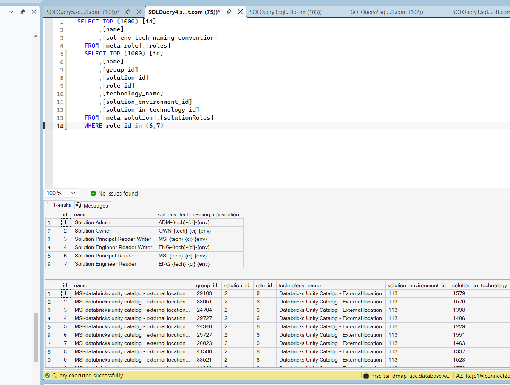


# Wave 4: Request & Other Family Migration Plan

Schema facts below were read directly from the live `dev`/`tst`/`acc`/`prd` databases (read-only
`sys.*`/`INFORMATION_SCHEMA` queries - no data or schema was changed anywhere to produce this plan).

**Scope** — unlike Wave 2/3 (Acc-only, since those are small, static reference tables), `meta_request`
holds real per-environment operational history: `requests` row counts are dev=348, tst=67, **acc=669**,
prd=1767, with **zero overlap** in `task_trace_uuid` across any pair of environments (confirmed by a
full cross-environment comparison) - dev/tst genuinely are NOT "the same data as Acc" here, they are
independent histories. **Decision: this wave is Acc-only for now; dev/tst are deferred to a later
wave.** `meta_other.tasks` is the one exception - **it loads from Acc daily** (see item 8), reusing
the existing `TR_MasterLoadAndValidate_Daily` schedule trigger (`adf/triggers/`, currently
`runtimeState: Stopped`), which already runs the whole `PL_MasterLoadAndValidate` chain once a day.

The six `uc*` tables (`ucAssignToMetastoreRequests`, `ucCreateAddUserGroupRequests`,
`ucCreateCatalogRequests`, `ucCreateExternalLocationRequests`, `ucCreateUpdateWorkspaceBindingRequests`,
`ucOnboardWorkspaceRequests`) are **out of scope for this wave** (confirmed) - revisit in a later wave.

| SourceSchema | SourceTable | TargetSchema | TargetTable | BusinessKeyColumns | LoadStrategy |
|---|---|---|---|---|---|
| `mig_stg_acc` | `vw_meta_request_requests` | `meta_request` | `requests` | `task_trace_uuid` | `UPSERT` |
| `mig_stg_acc` | `vw_meta_request_aclActionRequests` | `meta_request` | `aclActionRequests` | `id` | `SKIP_EXISTING` |
| `mig_stg_acc` | `vw_meta_request_aclCopyRequests` | `meta_request` | `aclCopyRequests` | `id` | `SKIP_EXISTING` |
| `mig_stg_acc` | `vw_meta_request_aclReapplyRequests` | `meta_request` | `aclReapplyRequests` | `id` | `SKIP_EXISTING` |
| `mig_stg_acc` | `vw_meta_request_dataCopyPrdLikeEnvRequests` | `meta_request` | `dataCopyPrdLikeEnvRequests` | `id` | `SKIP_EXISTING` |
| `mig_stg_acc` | `vw_meta_request_dataCopyRequests` | `meta_request` | `dataCopyRequests` | `id` | `SKIP_EXISTING` |
| `mig_stg_acc` | `vw_meta_request_dataDeletionRequests` | `meta_request` | `dataDeletionRequests` | `id` | `SKIP_EXISTING` |
| `mig_stg_acc` | `vw_meta_request_datasetAccessRemovalRequests` | `meta_request` | `datasetAccessRemovalRequests` | `id` | `SKIP_EXISTING` |
| `mig_stg_acc` | `vw_meta_request_datasetAccessRequests` | `meta_request` | `datasetAccessRequests` | `id` | `SKIP_EXISTING` |
| `mig_stg_acc` | `vw_meta_request_dynamicRequests` | `meta_request` | `dynamicRequests` | `id` | `SKIP_EXISTING` |
| `mig_stg_acc` | `vw_meta_request_environmentProdLikeRequests` | `meta_request` | `environmentProdLikeRequests` | `id` | `SKIP_EXISTING` |
| `mig_stg_acc` | `vw_meta_request_foldermappingCreateRequests` | `meta_request` | `foldermappingCreateRequests` | `id` | `SKIP_EXISTING` |
| `mig_stg_acc` | `vw_meta_request_folderMappingRequests` | `meta_request` | `folderMappingRequests` | `id` | `SKIP_EXISTING` |
| `mig_stg_acc` | `vw_meta_request_idmcGroupMembershipRequests` | `meta_request` | `idmcGroupMembershipRequests` | `id` | `SKIP_EXISTING` |
| `mig_stg_acc` | `vw_meta_request_idmcGroupRequests` | `meta_request` | `idmcGroupRequests` | `id` | `SKIP_EXISTING` |
| `mig_stg_acc` | `vw_meta_request_manual_upload_requests` | `meta_request` | `manual_upload_requests` | `id` | `SKIP_EXISTING` |
| `mig_stg_acc` | `vw_meta_request_removeSolutionInTechnologyRequests` | `meta_request` | `removeSolutionInTechnologyRequests` | `id` | `SKIP_EXISTING` |
| `mig_stg_acc` | `vw_meta_request_roleAssignmentRequests` | `meta_request` | `roleAssignmentRequests` | `id` | `SKIP_EXISTING` |
| `mig_stg_acc` | `vw_meta_request_requestResolutionNotes` | `meta_request` | `requestResolutionNotes` | `request_id` | `SKIP_EXISTING` |
| `mig_stg_acc` | `vw_meta_request_datasetDataOwnerRequests` | `meta_request` | `datasetDataOwnerRequests` | `layer,path` | `UPSERT` |
| `mig_stg_acc` | `vw_meta_other_tasks` | `meta_other` | `tasks` | `environment,source_id` | `UPSERT` |

**Scope — load only.** Same principle as Wave 2.1's `folderMapping`: adding the `environment`
column to `meta_request.requests`, and `environment`/`source_id` to `meta_other.tasks` (item 1
below), is **not** part of this wave's deliverable. That schema change is handled **separately**
(its own DACPAC/deployment change, rolled out across Dev/Tst/Acc/Prd, owned outside this
migration-load framework) and is a **blocking prerequisite**: all three columns must already exist
in Production before this wave's load runs. `scripts/Request-mapping.sql` and
`sql/validate-and-load/14_request_family_table_configuration.sql` both enforce this with a guard
check (same `IF NOT EXISTS (...) ... SET NOEXEC ON` pattern as `scripts/FolderMapping-mapping.sql` /
`sql/validate-and-load/15_folderMapping_environment_table_configuration.sql`) - if any of the three
columns aren't there yet, the rest of the script is skipped rather than registering a load that
would fail or load against an incomplete business key.

1. **Schema changes needed before this wave can load (proposed here, NOT applied - the team
   reviews and runs these through the normal DB deployment/DACPAC process, same as any other
   schema change; this wave's load scripts enforce it as a prerequisite, see "Scope" above)**:
   - `meta_request.requests` needs a new `environment VARCHAR(10) NOT NULL` column, in **all four**
     environments (confirmed: none of dev/tst/acc/prd currently has it). Reason: this is the first
     wave where more than one source environment's rows can land in the same Production table over
     time (today Acc only, but the column exists from day one so future dev/tst waves don't need
     another schema change) - `environment` records which source each row came from. Rollout
     approach: add the column nullable first, backfill existing rows per-environment (`'acc'` in
     Acc, `'dev'` in dev, `'tst'` in test, and a value for Production's own 1767 pre-existing
     native rows, e.g. `'prd'`), then enforce `NOT NULL` - this keeps the DACPAC schema definition
     itself environment-agnostic (no per-environment default baked into source control).
   - **Open item for the team**: who sets `environment` for *new* requests raised natively in each
     environment going forward (dev/tst/acc/prd), once this migration has back-filled the
     historical rows? That's an application-level change (the request-raising API/service), outside
     this SQL migration framework's scope - flagged here so it doesn't get missed.
   - `meta_other.tasks` needs two new columns to support its **daily, repeatable** load (see item
     8): `environment VARCHAR(10) NOT NULL` and `source_id INT NOT NULL` (the originating
     environment's own `tasks.id`, captured verbatim so day-over-day reruns can tell "already
     loaded" from "new"). `tasks` has no existing natural key at all (only a surrogate `IDENTITY
     id`, confirmed via `sys.identity_columns`), so unlike `requests` (which has `task_trace_uuid`
     already available), `tasks` needs this pair of columns added specifically to make repeatable
     loads possible.
   - `meta_request.datasetDataOwnerRequests.id` needs to become `IDENTITY` (confirmed live: it is
     currently a plain, non-identity `int` PK, and nothing references it via FK). Agreed with the
     team: **its `id` value is never migrated/copied** (not needed - `(layer,path)` is the business
     key, not `id`) - once it's `IDENTITY`, Production generates a fresh id on insert exactly like
     `requests.id` already does (`IdentityInsertMode = 'AUTO'`), with zero collision risk against
     Acc's independently-numbered `id` range.
2. **The core design problem: `requests.id` is a shared PK that fans out to 18 tables** - confirmed
   via live FK metadata: `requests.id` (`IDENTITY`) is referenced by 17 child/detail tables' own
   `id` column (also their PK, e.g. `aclActionRequests.id`, `roleAssignmentRequests.id`,
   `dynamicRequests.id`, ...) plus `requestResolutionNotes.request_id` - a classic one-row-per-request
   detail-table pattern, one child row per `request_type`. Every one of those 18 child/detail
   tables' PK column is a **plain `int`, not `IDENTITY`** (confirmed via `sys.identity_columns`),
   so the generic `mig.usp_LoadValidatedTableToProduction` engine will simply copy whatever value a
   view supplies for that column - we just need the view to supply the *right* (Production) value,
   exactly like Wave 3 already does for `role_id`. The six `uc*` tables also have `id` as their PK
   but **no declared FK** to `requests.id` - out of scope for this wave regardless (see Scope above).
   `datasetDataOwnerRequests` likewise has **no FK to `requests.id`** (confirmed) - it's an
   independent table with its own surrogate `id` (becoming `IDENTITY` per item 1 - its `id` value
   is never migrated), resolved only by its own business key (`layer,path`, agreed with the team),
   not by the request bridge below.
3. **Request-id bridge (Acc only)** - since Production generates a *brand-new* `requests.id` on
   insert (`IdentityInsertMode = 'AUTO'`), every one of the 18 child/detail tables needs that new id
   substituted in for Acc's own `id`/`request_id` value. This reuses the **exact same same-wave
   pattern already established in Wave 3** for `solutionInTechnologies` → `solutionRoles`: a bridge
   view, `mig_stg_acc.vw_meta_request_requests_bridge`, resolves Acc's `requests.id` to
   **Production's** `requests.id` by matching on `task_trace_uuid` (confirmed globally unique - zero
   duplicates within any environment, zero collisions across all four environments) - not a staged
   bridge, a live join against Production's own (just-loaded-this-wave) `requests` table, because
   `requests` loads earlier in this same wave, not pre-existing like Wave 3's `solutions`. Every
   child/detail view's `id`/`request_id` column resolves through this bridge; any Acc row whose
   `task_trace_uuid` isn't in Production yet is excluded (`INNER JOIN`) rather than loaded with a
   wrong/`NULL` id - the same "unresolved FK blocks the row" rule as every other wave.
4. **Identity resolution reused, no new mapping** - `requested_by_user_id`/`processed_by_user_id`
   (on `requests`) and `owner_1_user_id`/`owner_2_user_id`/`owner_3_user_id` (on
   `datasetDataOwnerRequests`) are surrogate FKs into `actual_identity.users.id`. Confirmed live:
   `mig.actual_identity_identities_mapping` **already has `dev_id`/`tst_id`/`acc_id`/`prd_id`
   columns side by side**, keyed by `entra_id` (47,405 rows) - this wave reuses it as-is (join on
   `acc_id`, output `prd_id`), exactly like Wave 2's `owner_*_user_id` - no new mapping table needed.
   `identity_entra_id` (`aclActionRequests`, `aclReapplyRequests`), `group_entra_id`
   (`datasetAccessRequests`, `datasetAccessRemovalRequests`, `roleAssignmentRequests`) and
   `group_owner_entra_id` (out-of-scope `uc*` tables) are already `entra_id` values, not surrogate
   ids - per the established Wave 1 design (`entra_id` is the business key for
   `actual_identity.identities`, identical across all environments) these pass through **completely
   unchanged**, no bridge needed.
5. **Careful: some child tables have their *own*, unrelated `environment` column already** -
   `environmentProdLikeRequests`, `idmcGroupMembershipRequests`, `idmcGroupRequests`,
   `removeSolutionInTechnologyRequests` and `roleAssignmentRequests` already have an `environment`
   column, but it means something different: *which environment the requested action targets*
   (e.g. "assign this role in Dev"), not *which source database this row was migrated from*. These
   pass through completely unchanged, like any other plain data column - do not confuse this with
   the new `requests.environment`/`tasks.environment` columns from item 1, which record migration
   provenance. No naming collision in practice (different tables), just worth calling out so no one
   conflates the two meanings.
6. **Load order** - `requests` must load before all 17 child/detail tables (they resolve against
   its just-loaded Production rows via the bridge in item 3) - proposed `LoadOrder = 60` for
   `requests`, `datasetDataOwnerRequests` and `tasks` (independent of `requests` and of each other),
   and `LoadOrder = 70` for the 17 child/detail tables + `requestResolutionNotes` (new values, after
   Wave 3's 40/50, so relative order is guaranteed globally without touching Wave 1-3's tiers).
7. **Load Strategy** (agreed with the team) - `UPSERT` for `requests` (its `status`,
   `processed_by_user_id`, `processed_at`, `reason_completed`, `completed_at`, `failed_reason`,
   `failed_at` lifecycle fields can change after a request is first raised, so reruns need to
   re-sync them) and for `datasetDataOwnerRequests`/`tasks` (owner reassignment / task status
   progression can likewise change after creation); `SKIP_EXISTING` for the 17 child/detail tables +
   `requestResolutionNotes`, since their columns (`storage_account`, `path`, `role`, ...) are set
   once at request-creation time and don't change afterwards.
8. **`meta_other.tasks` - daily, Acc-only, independent of `requests`** (agreed with the team) - no
   FK in or out (confirmed via live FK metadata - genuinely standalone), and it runs on the existing
   daily cadence (`TR_MasterLoadAndValidate_Daily`, currently `Stopped`), not a one-off historical
   backfill. Since it has no natural key at all, item 1's new `environment`/`source_id` columns are
   what make `UPSERT` safe on every daily run - `BusinessKeyColumns = environment,source_id` lets it
   both insert newly-created Acc tasks and re-sync `status`/`started_at`/`failed_at`/`completed_at`
   for tasks that were still in-flight on a previous day's run.
9. **Cross-wave dependency, informational only** - `meta_datalake.datasetPermissions.created_by_request_id`
   (loaded already in Wave 2) is a nullable FK to `requests.id`. Confirmed live: 82 of 5,146 rows are
   non-null in Production, and **all 82 already resolve** to an existing Production `requests.id` (0
   orphaned) - not broken today (those 82 are presumably Production-native rows created after Wave
   1/2 went live, not migrated ones), so this wave requires no backfill of `datasetPermissions`. Flagged
   here only so a future re-run/reload of `datasetPermissions` from a source environment knows it
   would need the same kind of id-remap treatment as this wave's `requests`.
10. **Flag for the team — `datasetDataOwnerRequests.id` may actually *be* the request's `id`,
    contradicting items 1/2's "no FK" design** — items 1 and 2 conclude `datasetDataOwnerRequests`
    has **no declared FK** to `requests.id` (confirmed via live `sys.foreign_keys` metadata) and
    therefore treat its `id` as its own independent surrogate (never migrated, `(layer,path)` as the
    business key, becoming `IDENTITY`). If the application intent is actually that
    `datasetDataOwnerRequests.id` **equals** the owning request's `id` (i.e. the same one-row-per-
    request pattern as the 17 child tables, just missing the FK *constraint*, not missing the
    relationship itself), that changes the design materially - this must be settled before go-live,
    not assumed either way.
    - **Validation query (run per environment)**:
      ```sql
      SELECT d.id, r.id AS matching_requests_id, r.task_trace_uuid
      FROM meta_request.datasetDataOwnerRequests AS d
      LEFT JOIN meta_request.requests AS r ON r.id = d.id;
      ```
      If every `datasetDataOwnerRequests.id` matches an existing `requests.id` (no NULLs in
      `matching_requests_id`), that's strong evidence the ids are deliberately shared with
      `requests`, not coincidental.
    - **If confirmed (`id` = the owning request's `id`)** — switch to the **same bridge pattern as
      the 17 child tables** instead of items 1/2's `IDENTITY` design: keep `id` a plain `int` (not
      `IDENTITY` - its value must be explicitly supplied via the bridge, not auto-generated); change
      the business key from `(layer,path)` to `id`; move `LoadOrder` from `60` to `70` (it would now
      depend on `requests` loading first, same as the 17 children); and have
      `vw_meta_request_datasetDataOwnerRequests` join `vw_meta_request_requests_bridge` and project
      `rb.prd_id AS id`, exactly like `vw_meta_request_aclActionRequests`. Worth also adding the
      missing FK constraint (`datasetDataOwnerRequests.id` → `requests.id`) at the same time, so the
      schema's declared metadata matches reality and this ambiguity can't recur.
    - **If not confirmed (truly independent/coincidental ids)** — items 1/2's current design stands
      unchanged: `IDENTITY`, `(layer,path)` business key, `LoadOrder = 60`.
    - A ready-to-enable alternate view/config for the "confirmed" branch is prepared (commented out,
      not applied) in `scripts/Request-mapping.sql` and
      `sql/validate-and-load/14_request_family_table_configuration.sql`.

**Go/No-Go**

| Area | Question | Team Input |
|---|---|---|
| Scope | Confirmed: Acc-only for `requests`/its 17 child tables/`requestResolutionNotes`/`datasetDataOwnerRequests`; dev/tst deferred to a later wave; `uc*` tables out of scope for this wave. | Confirmed |
| `requests`/`tasks` schema change | Agree the `environment` (both tables) and `source_id` (`tasks` only) columns, and the "add nullable → backfill per-env → enforce NOT NULL" rollout approach in item 1? This is an out-of-scope prerequisite for this (load-only) wave, enforced by a guard check in `scripts/Request-mapping.sql`/`sql/validate-and-load/14_request_family_table_configuration.sql` (same pattern as Wave 2.1's folderMapping). | |
| App-level follow-up | Who updates the request-raising API/service so *new* requests/tasks in each environment populate `environment` (and `tasks.source_id`) going forward? | |
| `datasetDataOwnerRequests.id` | **New, from item 10**: run the validation query and confirm whether `id` represents the owning `requests.id` (no FK declared today) - decides `IDENTITY` vs. bridge-based `id`, and business key `(layer,path)` vs. `id`. | |
| Business Keys | Agree `task_trace_uuid` for `requests`, `id`/`request_id` for the 17 child tables + `requestResolutionNotes`, `(layer,path)` for `datasetDataOwnerRequests` **pending item 10**, `(environment,source_id)` for `tasks`? | |
| Load Strategy | Confirmed: `UPSERT` for `requests`/`datasetDataOwnerRequests`/`tasks`; `SKIP_EXISTING` for the 17 child tables + `requestResolutionNotes`. | Confirmed |
| Load Order | Agree `requests`/`datasetDataOwnerRequests`/`tasks` (60) must load before the 17 child tables + `requestResolutionNotes` (70)? **`datasetDataOwnerRequests` may move to 70, pending item 10.** | |
| `tasks` cadence | Confirmed: daily, via the existing `TR_MasterLoadAndValidate_Daily` trigger (currently `Stopped` - needs to be started once this wave goes live). | Confirmed |
| Go / No-Go | Final decision | |


# Rollback

Upon disaster, restore configured as PiTR (Point-in-Time Restore) 1 week before.


