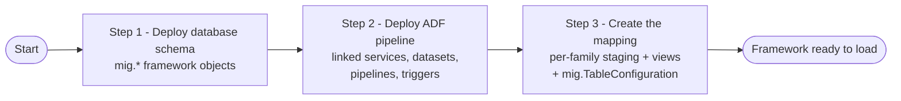

# Team Handover Runbook — Load-to-Production Migration Framework

**Audience:** the team taking over day-to-day operation of this framework.
**Scope:** "Strategy 1 — Load to Production" (lower environments → Prod), the ADF pipeline chain,
and the `mig.*` metadata that drives it. This is a **how-to** companion — the **why/what** (design
decisions, schema facts, Go/No-Go sign-off per wave) always lives in
[Database-Migration-Execution.md](./Database-Migration-Execution.md); when in doubt, that file wins.
"Strategy 2 — sync Production back down to lower environments" is a separate, mostly-independent
piece — see [Synchronise/README.md](./Synchronise/README.md) if you need that instead.

This runbook deliberately stays high-level: each section is a short recipe that points at the real
files to run/edit, rather than re-explaining everything those files already document.

> **⚠️ Before you copy any example command below:** every example uses
> `AZ-RajS1@connect2dll.onmicrosoft.com` / tenant `07751f8b-9617-49d5-9024-85f034f400ec` purely as
> an illustration of the *shape* of the command. **Replace the account email (and tenant, if yours
> differs) with your own Azure AD identity** before running — these scripts sign in interactively
> via `Connect-AzAccount`, so whoever runs the command needs their own AAD account with the right
> permissions on the target resources (not the example account above).

---

## Framework setup at a glance

If you're standing this framework up in a brand-new environment, the three big phases happen in
this order:



**How-to steps, matching the diagram above:**

1. **Deploy the database schema** (→ Section 4.A) — creates every `mig.*` object the framework
   needs (`metadata_loadToStaging`, `TableConfiguration`, `ValidationRun`, `ValidationError`,
   `LoadRun`, `MasterRun`, `StagingLoadRun`, and the validate/load stored procedures). No
   sample/test data is inserted — this is schema only.
   ```powershell
   # Example — replace -UserName with YOUR OWN Azure AD sign-in, not this one:
   .\deploy-migration-config-production.ps1 -RunSchemaDeployment -UserName "AZ-RajS1@connect2dll.onmicrosoft.com"
   ```
2. **Deploy the ADF pipeline** (→ Section 3) — publishes linked services, datasets, the 5
   pipelines and the daily trigger into the existing Data Factory (`MSC-DAF-DMAPSB-MGPOC`). Confirm
   each SQL database already has the one-time managed-identity contained user described in the
   script's header (`CREATE USER [MSC-DAF-DMAPSB-MGPOC] FROM EXTERNAL PROVIDER; ...`) before
   running it.
   > **⚠️ This is an already-running, live Data Factory — not a fresh/empty one.** Double-check the
   > script's parameters (subscription/resource group/factory name, and each environment's SQL
   > server FQDN + database name) before running — see Section 3 for exactly which ones and why.

   
   ```powershell
   # Example — replace -AccountId with YOUR OWN Azure AD sign-in, not this one:
   .\deploy-real-environment.ps1 -TenantId "07751f8b-9617-49d5-9024-85f034f400ec" -AccountId "AZ-RajS1@connect2dll.onmicrosoft.com"
   ```
3. **Create the mapping** (→ Section 5) — for every table family you want to bring up, write/run:
   - `scripts/<Family>-mapping.sql` — registers Phase-1 staging (`mig.metadata_loadToStaging`) and
     any views needed (identity resolution, id bridges, `Environment` tagging).
   - `sql/validate-and-load/<NN>_<family>_table_configuration.sql` — registers Phase-2
     `mig.TableConfiguration` rows, inactive (`IsActive = 0`) by default.
   Both of these you run manually (SSMS/`sqlcmd`/`Invoke-Sqlcmd`) in that order — see Section 4.B.
4. **Validate and activate** (→ Sections 6 and 7) — run the dry-run/sanity checks, get Go/No-Go
   sign-off, then flip `IsActive = 1` for each row via the commented-out activation block at the
   bottom of each `..._table_configuration.sql` script (→ Section 1, step 6).
5. **Go live** (→ Section 3) — trigger `PL_MasterLoadAndValidate` manually from ADF Studio to
   confirm the whole chain works end to end, then start `TR_MasterLoadAndValidate_Daily` once ready
   for an ongoing schedule.

Once the framework is up, bringing in each *additional* table/family afterwards is just steps 3–5
above — see the "onboarding a new table/family" checklist later in this runbook for the fuller
version of that loop.

---

## Quick reference — where things live

| Area | Location |
|---|---|
| Master plan, decision logic, Mermaid flows, per-wave design + Go/No-Go | [Database-Migration-Execution.md](./Database-Migration-Execution.md) |
| Framework schema/procs (`mig.*`) | [sql/13_mig_metadata_loadToStaging.sql](./sql/13_mig_metadata_loadToStaging.sql), [sql/14_add_id_to_metadata_lp.sql](./sql/14_add_id_to_metadata_lp.sql), [sql/validate-and-load/](./sql/validate-and-load/) `01`–`11` |
| Per-family mapping/view prep scripts | [scripts/Identity-mapping.sql](./scripts/Identity-mapping.sql), [scripts/Datalake-mapping.sql](./scripts/Datalake-mapping.sql), [scripts/FolderMapping-mapping.sql](./scripts/FolderMapping-mapping.sql), [scripts/Solution-mapping.sql](./scripts/Solution-mapping.sql), [scripts/Request-mapping.sql](./scripts/Request-mapping.sql) |
| Per-family `mig.TableConfiguration` registration | [sql/validate-and-load/10_identity_family_table_configuration.sql](./sql/validate-and-load/10_identity_family_table_configuration.sql), `12_datalake_...`, `13_solution_...`, `14_request_...`, `15_folderMapping_...` (same folder) |
| Pre-load dry run / duplicate checks | [scripts/preview_identity_family_load.sql](./scripts/preview_identity_family_load.sql), `preview_datalake_family_load.sql`, `preview_solution_family_load.sql`, `preview_request_family_load.sql`, [scripts/check_datalake_family_duplicates.sql](./scripts/check_datalake_family_duplicates.sql) |
| ADF pipelines / datasets / linked services / triggers | [adf/pipelines/](./adf/pipelines/), [adf/datasets/](./adf/datasets/), [adf/linkedServices-real/](./adf/linkedServices-real/), [adf/triggers/](./adf/triggers/) |
| Deployment scripts | [deploy-migration-config-production.ps1](./deploy-migration-config-production.ps1), [deploy-real-environment.ps1](./deploy-real-environment.ps1), [refresh-identity-mapping.ps1](./refresh-identity-mapping.ps1), [deploy.ps1](./deploy.ps1) / [deploy-validate-and-load.ps1](./deploy-validate-and-load.ps1) (local POC only) |
| Deep design reference (field-by-field) | [metadata-validation-loadtoProduction.md](./metadata-validation-loadtoProduction.md), [Load-to-Staging-DEPLOY_AND_TEST_GUIDE.md](./Load-to-Staging-DEPLOY_AND_TEST_GUIDE.md), [Validate-and-load-Deploy-and-Test-Guide.md](./Validate-and-load-Deploy-and-Test-Guide.md) |

---

## 1. Add a new table: copy-to-staging, then make it load

1. **Pick the source(s) and target.** Decide which environment(s) (`dev`/`tst`/`acc`) the table
   loads from, and the Production `TargetSchema.TargetTable`. See
   [Database-Migration-Execution.md](./Database-Migration-Execution.md)'s per-wave sections for
   worked examples (e.g. Acc-only vs. multi-source like Wave 2.1's `folderMapping`).
2. **Register "copy to staging" (Phase 1)** — insert one row per source environment into
   `mig.metadata_loadToStaging` (`SchemaName`, `TableName`, `Env`, `Loadtostaging = 1`). Copy the
   pattern from any `scripts/*-mapping.sql` file's `INSERT INTO [mig].[metadata_loadToStaging]`
   block. This is what makes `PL_LoadAllToStaging` create/refresh
   `mig_stg_<env>.<Schema>_<TableName>` automatically (no manual staging DDL needed — the pipeline
   builds the staging table from the source table's live column list every run).
3. **Decide if you need a view** instead of pointing straight at the raw staging table (identity
   resolution, id bridging, or an `Environment` literal) — see Section 5.
4. **Register "load to Production" (Phase 2)** — add the table to `mig.TableConfiguration`
   (Section 2), inserted with `IsActive = 0`.
5. **Validate first** — run the family's preview/sanity-check script (Section 6) and get the
   Go/No-Go items for that table signed off in
   [Database-Migration-Execution.md](./Database-Migration-Execution.md).
6. **"Keep the active part to have the load" = flip `IsActive` to `1`.** Every per-family
   registration script (`sql/validate-and-load/<NN>_<family>_table_configuration.sql`) ends with a
   commented-out activation block, e.g.:
   ```sql
   -- UPDATE mig.TableConfiguration
   -- SET IsActive = 1, ModifiedDate = SYSUTCDATETIME()
   -- WHERE (SourceSchema, SourceTable, TargetSchema, TargetTable) IN ( ... );
   -- GO
   ```
   Uncomment and run **only** once every Go/No-Go item for that table/family is resolved. Until
   then, re-running the registration script is always safe — it never silently re-activates a row.

---

## 2. Add / update a `mig.TableConfiguration` row

`mig.TableConfiguration` is the single control table `PL_ValidateAndLoadAllToProduction` reads to
know what to load and how. Table defined in
[sql/validate-and-load/01_mig_table_configuration.sql](./sql/validate-and-load/01_mig_table_configuration.sql);
field-by-field semantics in
[metadata-validation-loadtoProduction.md](./metadata-validation-loadtoProduction.md) section 4.

| Column | Meaning |
|---|---|
| `SourceSchema` / `SourceTable` | Staging schema/table (or view) to read from, e.g. `mig_stg_acc` / `vw_actual_datalake_datasets` |
| `TargetSchema` / `TargetTable` | Production table to load into |
| `BusinessKeyColumns` | Comma-separated columns that identify "the same row" (see Section 7) |
| `LoadStrategy` | `SKIP_EXISTING` / `UPSERT` / `INSERT_IF_NOT_EXISTS` (Section 7) |
| `LoadOrder` | Lower runs first; use the next free tier after the highest existing wave (10/20/30/40/50/60/70 so far) |
| `IdentityInsertMode` | `AUTO` (Production generates a new id) or `COPY` (explicitly copy the staging id under `SET IDENTITY_INSERT`) — `COPY` only when something else has an unchanged FK to that id |
| `IsActive` | Whether `PL_ValidateAndLoadAllToProduction` actually loads this row today |

**Don't hand-write `INSERT`/`UPDATE` statements against this table.** Always add new rows (or
change existing ones) via a `MERGE ... WHEN MATCHED / WHEN NOT MATCHED` script, following the
established per-family pattern (copy the closest `sql/validate-and-load/<NN>_<family>_table_configuration.sql`
file). This keeps re-runs idempotent and keeps `IsActive` behavior consistent (new rows `= 0`;
re-running after go-live keeps it `0` until the explicit activation block at the bottom is run —
see Section 1, step 6).

---

## 3. ADF pipeline changes — how to deploy and run them

**Where things live:** [adf/pipelines/](./adf/pipelines/) (5 pipelines), [adf/datasets/](./adf/datasets/),
[adf/linkedServices-real/](./adf/linkedServices-real/) (managed-identity auth, real environment),
[adf/triggers/](./adf/triggers/).

**Pipeline chain:**
- `PL_LoadSourceToStaging` — copies **one** source table into staging (manual/ad-hoc use).
- `PL_LoadAllToStaging` — metadata-driven: loops every `mig.metadata_loadToStaging` row with
  `Loadtostaging = 1`.
- `PL_ValidateAndLoadToProduction` — validates + loads **one** table.
- `PL_ValidateAndLoadAllToProduction` — metadata-driven: loops every `mig.TableConfiguration` row
  with `IsActive = 1`, in `LoadOrder`, refreshing `mig.actual_identity_identities_mapping` between
  the `LoadOrder ≤ 10` and `LoadOrder > 10` phases.
- `PL_MasterLoadAndValidate` — orchestrates the whole chain (staging, then validate+load) end to
  end; this is what `TR_MasterLoadAndValidate_Daily` triggers.

**To change/deploy a pipeline (or dataset/linked service/trigger) in the real environment:**
1. Edit the JSON under `adf/` (pipelines/datasets/triggers; linked services under
   `adf/linkedServices-real`). **Adding a brand-new pipeline** (not just editing an existing one)?
   Add its JSON file under `adf/pipelines/` (plus any new dataset under `adf/datasets/` or linked
   service under `adf/linkedServices-real/` it needs) **before** running the deploy script in step
   2 — the script auto-discovers and publishes **every** `.json` file it finds in those four
   folders (and topologically sorts multi-level `ExecutePipeline` chains automatically); it does
   not keep a separate, hand-maintained list of pipelines to publish, so a new file left out of
   those folders simply never gets deployed.
2. Run [deploy-real-environment.ps1](./deploy-real-environment.ps1) — publishes into the existing
   `MSC-DAF-DMAPSB-MGPOC` factory (it never creates the factory or any SQL database; see the
   script's header for the one-time managed-identity `CREATE USER ... FROM EXTERNAL PROVIDER` setup
   each SQL database needs).
   > **⚠️ Highlight: `MSC-DAF-DMAPSB-MGPOC` is an already-running, live Data Factory instance, not
   > a disposable/empty one.** Before running, confirm/update the script's parameters so every
   > linked service ends up pointing at the right thing:
   > | Parameter | Controls |
   > |---|---|
   > | `-SubscriptionName`, `-ResourceGroupName`, `-DataFactoryName` | *Which* existing Data Factory to publish into |
   > | `-DevServerInstance` / `-TstServerInstance` / `-AccServerInstance` / `-PrdServerInstance` | The actual SQL Server FQDN each environment's linked service connects to |
   > | `-DatabaseName` | The database name on every one of those servers (`DMAP` today) |
   >
   > These values get substituted straight into the `adf/linkedServices-real/*.json` templates'
   > `{{SOURCE_DEV_SQL_SERVER_FQDN}}` / `{{SOURCE_TEST_SQL_SERVER_FQDN}}` /
   > `{{SOURCE_ACC_SQL_SERVER_FQDN}}` / `{{TARGET_SQL_SERVER_FQDN}}` / `{{DMAP_DATABASE_NAME}}`
   > placeholders (see the script's `param(...)` block and the linked-service publish step) — get
   > one wrong and you re-point a **live** linked service at the wrong database.
   ```powershell
   # Example — replace -AccountId with YOUR OWN Azure AD sign-in, not this one:
   .\deploy-real-environment.ps1 -TenantId "07751f8b-9617-49d5-9024-85f034f400ec" -AccountId "AZ-RajS1@connect2dll.onmicrosoft.com"
   ```
3. Run the pipeline manually from ADF Studio ("Trigger now") to test, or let the schedule trigger
   pick it up.
4. `TR_MasterLoadAndValidate_Daily` is currently `Stopped` — only start it once a wave that depends
   on the daily cadence (e.g. Wave 4's `meta_other.tasks`) has gone live.

`deploy.ps1` (with `-DeployAdf`) is the **local/POC** equivalent — use it only for learning/testing
against `localhost`, never against the real environment.

---

## 4. Deploy database changes

Two different kinds of "database change" — don't mix them up:

**A. Framework objects (`mig.*` schema, tables, stored procedures)** — changes rarely, only when
the framework itself evolves (new load strategy, new audit column, etc.).
Run [deploy-migration-config-production.ps1](./deploy-migration-config-production.ps1) against the
real Prod server (`-RunSchemaDeployment` required to actually apply; omit it for a dry run). It
runs, in order: `sql/13_mig_metadata_loadToStaging.sql`, `sql/14_add_id_to_metadata_lp.sql`, then
everything under `sql/validate-and-load/01`–`11`. Uses Azure AD auth (`Connect-AzAccount`), no
SQL login/password.
```powershell
# Example — replace -UserName with YOUR OWN Azure AD sign-in, not this one:
.\deploy-migration-config-production.ps1 -RunSchemaDeployment -UserName "AZ-RajS1@connect2dll.onmicrosoft.com"
```

**B. Per-wave/family scripts (mapping views + `TableConfiguration` registration)** — changes every
time a new table/family is onboarded (Section 1 and 5). These are **not** wired into any `.ps1` yet
— run them manually (SSMS, `sqlcmd`, or `Invoke-Sqlcmd`) against the Prod server, in SQLCMD mode, in
this order: `scripts/<Family>-mapping.sql` → `sql/validate-and-load/<NN>_<family>_table_configuration.sql`.
Both files start with a **prerequisite guard** (`IF NOT EXISTS (...) ... SET NOEXEC ON`) that no-ops
the rest of the file if a required upstream condition isn't met yet — read the `RAISERROR` message
if a script "does nothing" when run.

**C. Schema changes to source/Production tables themselves** (new columns, e.g. the `Environment`
column pattern introduced in Wave 2.1 and reused in Wave 4) are **out of scope for this framework
entirely** — they go through the normal DACPAC/DB-deployment change process, in whichever
environments the design calls for, **before** the corresponding family's load scripts (B) are run.
This is exactly what the guards mentioned above check for. See each wave's "Schema change" item in
[Database-Migration-Execution.md](./Database-Migration-Execution.md) for what's required and why.

---

## 5. Create mapping views and run them family-wise

Every family has one prep script under [scripts/](./scripts/): `Identity-mapping.sql` (Wave 1),
`Datalake-mapping.sql` (Wave 2), `FolderMapping-mapping.sql` (Wave 2.1), `Solution-mapping.sql`
(Wave 3), `Request-mapping.sql` (Wave 4). They all follow the same shape:

1. Header comment — scope, prerequisites, mapping/bridge rationale, load order (copy this style).
2. `mig.metadata_loadToStaging` inserts (Section 1, step 2).
3. `CREATE OR ALTER VIEW mig_stg_<env>.vw_<schema>_<table>` — one per source table that needs
   transformation before it can load.
4. Sanity-check `SELECT`s at the bottom (Section 6).

**To onboard a new family, copy the closest existing file and work through this checklist per
table:**
- **Does it need identity resolution?** Join `mig.actual_identity_identities_mapping` (keyed by
  `entra_id`, has `dev_id`/`tst_id`/`acc_id`/`prd_id` side by side) — reused as-is in every wave so
  far, never re-create it.
- **Does it need a surrogate-id bridge?** If a staging table's id is a surrogate that Production
  will regenerate (`IdentityInsertMode = 'AUTO'`), and other tables in the *same wave* reference
  that id, add a bridge view matched on a natural key (see `Request-mapping.sql`'s
  `vw_meta_request_requests_bridge`, matched on `task_trace_uuid`, or `Solution-mapping.sql`'s
  natural-key bridges).
- **Does it need an `Environment` literal/column?** Only when the *same* Production table can
  receive rows from more than one source environment. Two supported patterns exist — pick based on
  whether the source side already carries the column:
  - *Column only in Production* (Wave 2.1 `folderMapping`, superseded design) — the view injects a
    literal `'dev'`/`'tst'`/`'acc'`.
  - *Column rolled out to every environment's own table* (Wave 2.1's current design, Wave 4) — no
    view injection needed; the column flows through staging automatically. This requires the
    prerequisite guard from Section 4.C.
- If none of the above apply, the view loads columns straight through unchanged — or skip the view
  entirely and point `mig.TableConfiguration` at the raw staging table (e.g. `datasetSizes`,
  `rawFolderMappingListOfValues`).

Then register the resulting view(s) in `mig.TableConfiguration` per Section 2.

---

## 6. How to do a sanity check

Run these **before** flipping any `IsActive` to `1`, and again after any change to a family's
views/config:

1. **Dry run (no writes):** `scripts/preview_<family>_family_load.sql` — shows, per row,
   `WILL BE INSERTED` / `WILL BE UPDATED` / `WILL FAIL VALIDATION (...)` / `ALREADY IN SYNC - no-op`,
   plus which rows are blocked by an unresolved FK. Run after `mig.usp_RefreshIdentityMapping` so
   identity/owner columns resolve correctly — either let the pipeline's own refresh step do it, or
   run it manually first with [refresh-identity-mapping.ps1](./refresh-identity-mapping.ps1):
   ```powershell
   # Example — replace -UserName with YOUR OWN Azure AD sign-in, not this one:
   .\refresh-identity-mapping.ps1 -UserName "AZ-RajS1@connect2dll.onmicrosoft.com"
   ```
2. **Duplicate business-key check:** `GROUP BY <BusinessKeyColumns> HAVING COUNT(*) > 1` against the
   actual configured source (the view, if one is used — not the raw table, since that's what the
   engine actually compares). See
   [scripts/check_datalake_family_duplicates.sql](./scripts/check_datalake_family_duplicates.sql)
   for the pattern to copy for a new family; any rows returned are a go-live blocker.
3. **Post-load check:** re-run the same duplicate query against the **Production** target table
   after a load, and check `mig.ValidationError`/`mig.LoadRun` for that `BatchId` — ready-made
   queries in [metadata-validation-loadtoProduction.md](./metadata-validation-loadtoProduction.md)
   section 14a and [Validate-and-load-Deploy-and-Test-Guide.md](./Validate-and-load-Deploy-and-Test-Guide.md)
   section 8d.
4. **Ongoing audit / "what happened on run X":** `mig.ValidationRun`, `mig.ValidationError`,
   `mig.LoadRun`, `mig.MasterRun`, `mig.StagingLoadRun` — "which tables failed", "why", "status for
   a BatchId" queries are in
   [metadata-validation-loadtoProduction.md](./metadata-validation-loadtoProduction.md) sections
   8–9 and 25–26.

---

## 7. Understand the load strategy and the plan

Three load strategies exist (full decision table and Mermaid flow at the top of
[Database-Migration-Execution.md](./Database-Migration-Execution.md); field-level semantics in
[metadata-validation-loadtoProduction.md](./metadata-validation-loadtoProduction.md) sections 5 and
13):

| Strategy | Not yet in Production | Already in Production (business key matches) |
|---|---|---|
| `SKIP_EXISTING` | Insert | Leave untouched (no-op, not an error) |
| `UPSERT` | Insert | Update with the staging value, only if something actually changed |
| `INSERT_IF_NOT_EXISTS` | Insert | No-op if values already match; **fail validation** (`BUSINESS_KEY_VALUE_MISMATCH`) if they differ |

**Rule of thumb for picking one:** data that's set once and never changes after creation (detail
rows, static reference data) → `SKIP_EXISTING`. Data with a lifecycle that legitimately changes
after creation (status, owner, timestamps) → `UPSERT`. Data where an unexpected change at the
business-key level should be investigated rather than silently applied (e.g. anything controlling
access/permissions) → `INSERT_IF_NOT_EXISTS` (see Wave 3's `solutionRoles`/`solutionInTechnologies`
for the reasoning).

**To understand a specific table/family's plan:** go to its section in
[Database-Migration-Execution.md](./Database-Migration-Execution.md) (one `# Wave N` section per
family) — each documents scope, schema prerequisites, mapping/bridge design, load order, the chosen
`LoadStrategy` with rationale, and a **Go/No-Go table** at the end. The Go/No-Go table is the
authoritative sign-off checklist — don't activate a table (Section 1, step 6) until every row in it
is resolved.

---

## Appendix: end-to-end checklist for onboarding a new table/family

1. Confirm scope + schema facts directly against the live databases (don't assume) — write them
   into a new `# Wave N` section in [Database-Migration-Execution.md](./Database-Migration-Execution.md).
2. If a schema change is needed (new column, `IDENTITY` change, etc.), get it scheduled through the
   normal DACPAC process — **separately**, as a prerequisite (Section 4.C).
3. Write/extend the family's `scripts/<Family>-mapping.sql` (Section 5): staging registration +
   views + sanity checks, guarded by the prerequisite check if step 2 applies.
4. Write/extend the family's `sql/validate-and-load/<NN>_<family>_table_configuration.sql`
   (Section 2): `MERGE` into `mig.TableConfiguration`, new rows `IsActive = 0`, guarded the same way.
5. Run the dry-run preview + duplicate checks (Section 6). Fix anything that doesn't look right.
6. Fill in the Go/No-Go table in the plan doc and get team sign-off (Section 7).
7. Deploy/confirm any ADF pipeline or trigger changes if needed (Section 3).
8. Run the commented-out activation `UPDATE ... SET IsActive = 1` block (Section 1, step 6).
9. Trigger `PL_MasterLoadAndValidate` (or wait for the daily trigger) and confirm via the audit
   queries (Section 6, item 4).

---

## Appendix: Setting up the framework from scratch

See [Framework setup at a glance](#framework-setup-at-a-glance) near the top of this runbook — the
Mermaid diagram and its step-by-step walkthrough (with exact commands) live there now, right next
to each other, so first-time setup and the quick-reference diagram stay in sync.
