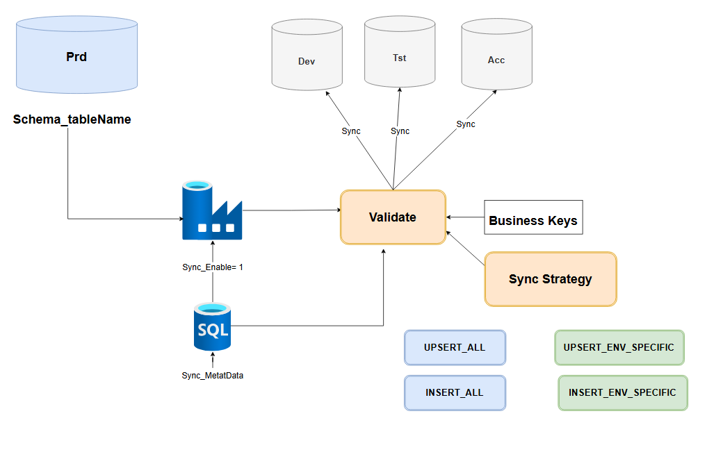
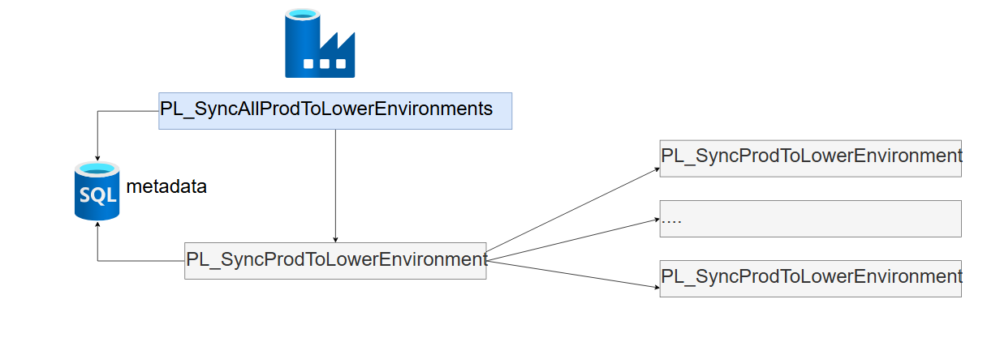
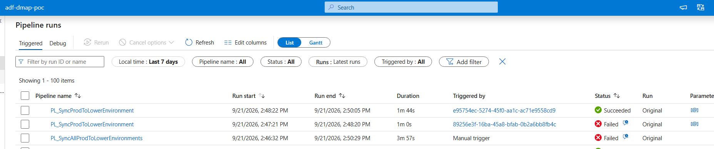
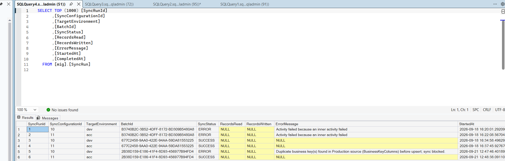

# Database Synchronization — Migration Execution Plan

This document is the migration execution plan for **Strategy 2: Production to Lower Environment
Synchronization** (see [README.md](README.md) for the full technical design). It is intended to
support a **Go / No-Go review meeting** with stakeholders ahead of executing the synchronization.

## Table of Contents

1. [Definition of the Synchronization](#1-definition-of-the-synchronization)
2. [Design Architecture](#2-design-architecture)
3. [Automation](#3-automation)
4. [Demo / Open Questions](#4-demo--open-questions)
5. [Pre-Migration Setup](#5-pre-migration-setup)
6. [Migration Wave for the Tables](#6-migration-wave-for-the-tables)
7. [Dependencies](#7-dependencies)
8. [Backup and Restore](#8-backup-and-restore)
9. [Testing](#9-testing)
10. [Go / No-Go Review Meeting](#10-go--no-go-review-meeting)

---

## 1. Definition of the Synchronization

The database being synchronized is **Production**, syncing data **down into each lower
environment** (Dev, Tst, Acc), so that reference/configuration data stays aligned across
environments without overwriting data that is specific to a given lower environment.

- **Direction:** Production → Dev / Tst / Acc (one-way; lower environments are never synced back
  up to Production as part of this process).
- **Scope of tables:** Each table is individually configured (`mig.SyncConfiguration`) as either:
  - **Environment-specific** — only the rows relevant to the target lower environment are synced.
  - **Non-environment-specific** — all rows are synced to every configured target environment.
- **Method:** `UPSERT` (or insert-only, depending on `SyncStrategy`), keyed on each table's
  configured business key(s) — never a full table replace/truncate.
- **Frequency:** [TBC — on-demand trigger vs. scheduled trigger; to be confirmed at the Go/No-Go
  meeting].
- **Out of scope:** Deletes on the Production side are not currently propagated (rows removed from
  Production are not removed from lower environments).

## 2. Design Architecture

See [README.md § Design](README.md#design) for the full breakdown of `mig.SyncConfiguration`
columns and `SyncStrategy` values (`UPSERT_ALL`, `INSERT_ALL`, `UPSERT_ENV_SPECIFIC`,
`INSERT_ENV_SPECIFIC`).

## 3. Automation

Automation is implemented as two ADF pipelines (see
[README.md § Pipelines](README.md#3-pipelines)):

- **`PL_SyncAllProdToLowerEnvironments`** — reads all active rows from `mig.SyncConfiguration` and
  fans out one `PL_SyncProdToLowerEnvironment` run per configuration row.
- **`PL_SyncProdToLowerEnvironment`** — syncs a single configured table into its target
  environment, with pre- and post-copy duplicate-key checks, and writes the outcome to
  `mig.SyncRun` / `mig.SyncMasterRun`.

### Initial Testing

1. **UPSERT works** — the Copy Activity correctly updates existing rows and inserts new rows in
   the target lower environment, matched on the configured business key(s).
2. **Duplicate business key is caught** — if the source data contains a duplicate business key,
   the pre-copy duplicate check fails validation and the sync run fails (blocked before any data
   is copied).

## 4. Demo / Open Questions

- Show the Sync Pipeline Run

## 5. Pre-Migration Setup

- [ ] Deploy `mig` schema sync tables (`mig.SyncConfiguration`, `mig.SyncRun`,
      `mig.SyncMasterRun`) to the Production server via `.\deploy-synchronise.ps1`.
- [ ] Confirm/deploy ADF linked services and datasets for all target environments
      (`LS_ProdSqlMig`, `LS_SourceSqlMig_Dev/Test/Acc`, `DS_StagingTableMig`,
      `DS_SourceTableMig_Dev/Test/Acc`) via `..\deploy.ps1 -DeployAdf`.
- [ ] Publish `PL_SyncProdToLowerEnvironment` / `PL_SyncAllProdToLowerEnvironments` pipelines via
      `.\deploy-synchronise.ps1 -DeployAdf`.
- [ ] Confirm network/firewall access from ADF to Production and each lower environment SQL
      server.
- [ ] Populate `mig.SyncConfiguration` with the confirmed table list, `SyncStrategy`,
      `EnvironmentColumn`, and `BusinessKeyColumns` per table (see [§6](#6-migration-wave-for-the-tables)).
- [ ] Confirm access/permissions sign-off (mirrors the open question in
      [Database-Migration-Execution.md](../Database-Migration-Execution.md#open-question-access--deployment-approach-for-database-migration-automation)):
      ADF placement/RG, and whether `mig` schema objects can be created directly in Production.

## 6. Migration Wave for the Tables

The authoritative, up-to-date table list, wave grouping, and per-table sync settings are tracked in
the shared **Database Comparison** sheet, not duplicated here:

- **Reference sheet:** [DatabaseComparison.xlsx](https://connect2dll.sharepoint.com/:x:/r/sites/DMAPWiki-DMAPCollaboration/_layouts/15/Doc.aspx?sourcedoc=%7B8C487840-68EA-4F7C-9C68-0FAC5BD53350%7D&file=DatabaseComparison.xlsx&action=default&mobileredirect=true&wdwpf=doclib-c)

Tables should be synced in waves, ordered by dependency (see [§7](#7-dependencies)) and risk —
lowest-risk / reference tables first, followed by tables with more complex dependencies. The wave
number, `SyncStrategy`, and target environment(s) for each table must be filled in on the sheet
above before being carried into `mig.SyncConfiguration` (see [§5](#5-pre-migration-setup)).

- [ ] Help fill the sheet: for each table in scope, confirm and record:
  - Wave number (sync order)
  - `SyncStrategy` (`UPSERT_ALL` / `INSERT_ALL` / `UPSERT_ENV_SPECIFIC` / `INSERT_ENV_SPECIFIC`)
  - Target environment(s) (Dev / Tst / Acc)
  - `EnvironmentColumn` (if environment-specific)
  - `BusinessKeyColumns`
- [ ] Review and agree the wave grouping/order with environment owners before Pre-Migration Setup
      is signed off.
- [ ] Once confirmed, use the sheet as the single source of truth to populate
      `mig.SyncConfiguration`.

## 7. Dependencies

- [ ] Foreign-key / referential dependencies between tables — parent (reference) tables must be
      synced before dependent/child tables.
- [ ] ADF availability and connectivity to Production + all lower environments.
- [ ] Completion of [Strategy 1: Load to Production](../Database-Migration-Execution.md#strategy-1-load-to-production)
      for any table whose Production data this sync depends on being up to date.
- [ ] Application/downtime windows in each lower environment, if applicable.
- [ ] [Add any environment-specific or team dependencies here.]

## 8. Backup and Restore

- [ ] Take a backup of each target lower environment (Dev, Tst, Acc) immediately before running
      the sync, so any unwanted UPSERT can be rolled back.
- [ ] Confirm backup retention window and restore procedure/owner for each environment.
- [ ] Document the restore runbook (steps + estimated time) to be used if a sync run needs to be
      reverted.
- [ ] No backup of Production is required for this direction of sync, since Production is only
      read from, never written to.

## 9. Testing

Testing is split into **Technical Testing** (pipeline/infrastructure mechanics) and
**Functional Testing** (business/data correctness), reviewed separately at the Go/No-Go meeting.

### Technical Test

- [ ] Unit test: run `PL_SyncProdToLowerEnvironment` against the `dbo.CI_AIC` test table (see
      [README.md](README.md#folder-layout)) on a single environment and verify UPSERT behavior.
- [ ] Duplicate-key check: confirm the pre- and post-copy duplicate checks correctly block a sync
      when duplicate business keys are present.
- [ ] Trial run on a small set of production-representative tables (mirrors the open item in
      [Database-Migration-Execution.md](../Database-Migration-Execution.md#open-points-from-demo)).
- [ ] Full dry run of `PL_SyncAllProdToLowerEnvironments` against a non-production-critical
      environment.
- [ ] Verify `mig.SyncRun` / `mig.SyncMasterRun` audit rows match expected outcomes (row counts,
      status) for every table in the wave.

### Functional Test

- [ ] **TBC — to be defined with the team.** Functional test scope/cases are not yet known;
      needs a follow-up discussion to confirm what business/data validation is required beyond
      the technical pipeline checks above.
- [ ] Sign-off from environment owners (Dev/Tst/Acc) that synced data is correct and does not
      overwrite environment-specific data unexpectedly.

## 10. Go / No-Go Review Meeting

**Purpose:** Confirm readiness to execute the Production → Lower Environment synchronization in
line with the plan above.

**Attendees:** [TBC — migration lead, environment owners, DBA/infra, business stakeholders]

**Agenda:**

1. Review Sections 1–9 above and confirm all Pre-Migration Setup and Testing checklist items are
   complete.
2. Review outstanding [Demo / Open Questions](#4-demo--open-questions) — confirm answers or
   explicitly accept the risk of proceeding without them resolved.
3. Confirm backup and restore plan is in place and tested.
4. Confirm the migration wave order and go-live schedule.
5. **Decision:** Go / No-Go.
   - **Go** — proceed with Wave 1 as scheduled.
   - **No-Go** — capture blocking issues and re-schedule review.

**Sign-off:**

| Role | Name | Decision | Date |
|---|---|---|---|
| Migration Lead | | | |
| Environment Owner (Dev) | | | |
| Environment Owner (Tst) | | | |
| Environment Owner (Acc) | | | |
| DBA / Infra | | | |
