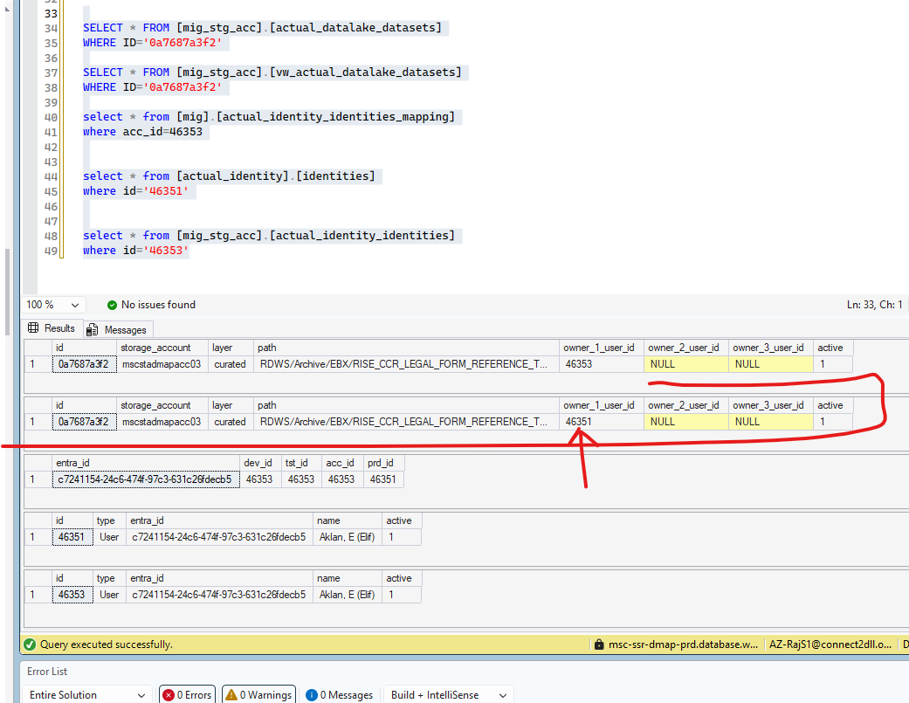
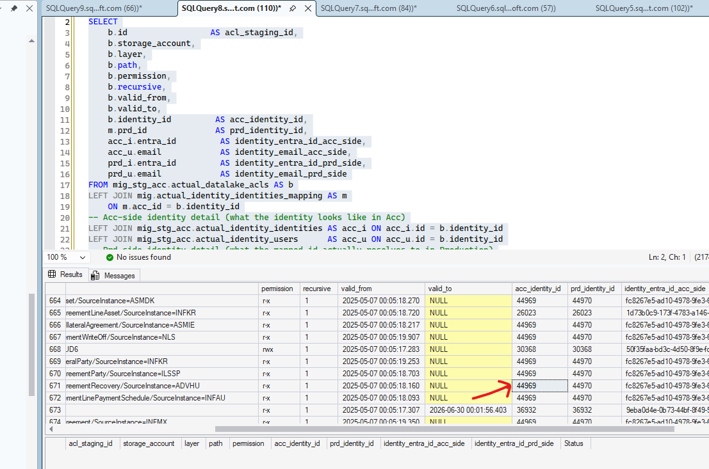
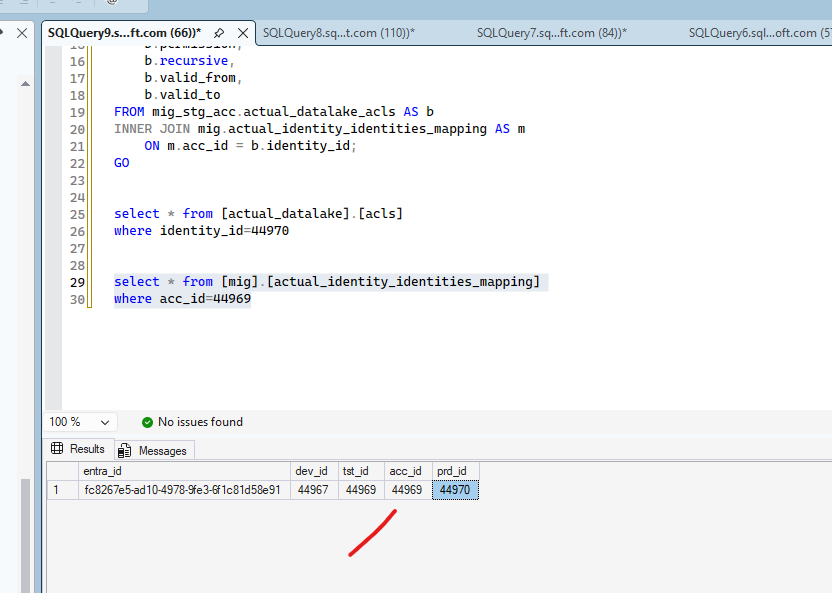

## Sanity Check

Performing on the sanity check for the user mapping under the Datasets table:

```
SELECT
    b.id                        AS dataset_id,
    b.owner_1_user_id           AS acc_owner_1_user_id,
    v.owner_1_user_id           AS prd_owner_1_user_id,
    acc_i1.entra_id             AS owner_1_entra_id_acc_side,
    acc_u1.email                AS owner_1_email_acc_side,
    prd_i1.entra_id             AS owner_1_entra_id_prd_side,
    prd_u1.email                AS owner_1_email_prd_side,

    b.owner_2_user_id           AS acc_owner_2_user_id,
    v.owner_2_user_id           AS prd_owner_2_user_id,
    acc_i2.entra_id             AS owner_2_entra_id_acc_side,
    acc_u2.email                AS owner_2_email_acc_side,
    prd_i2.entra_id             AS owner_2_entra_id_prd_side,
    prd_u2.email                AS owner_2_email_prd_side
FROM mig_stg_acc.actual_datalake_datasets AS b
JOIN mig_stg_acc.vw_actual_datalake_datasets AS v
    ON v.id = b.id
-- Acc-side identity detail (what the owner looks like in Acc)
LEFT JOIN mig_stg_acc.actual_identity_identities AS acc_i1 ON acc_i1.id = b.owner_1_user_id
LEFT JOIN mig_stg_acc.actual_identity_users      AS acc_u1 ON acc_u1.id = b.owner_1_user_id
LEFT JOIN mig_stg_acc.actual_identity_identities AS acc_i2 ON acc_i2.id = b.owner_2_user_id
LEFT JOIN mig_stg_acc.actual_identity_users      AS acc_u2 ON acc_u2.id = b.owner_2_user_id
-- Prd-side identity detail (what the mapped id actually resolves to in Production)
LEFT JOIN actual_identity.identities AS prd_i1 ON prd_i1.id = v.owner_1_user_id
LEFT JOIN actual_identity.users      AS prd_u1 ON prd_u1.id = v.owner_1_user_id
LEFT JOIN actual_identity.identities AS prd_i2 ON prd_i2.id = v.owner_2_user_id
LEFT JOIN actual_identity.users      AS prd_u2 ON prd_u2.id = v.owner_2_user_id
WHERE ISNULL(b.owner_1_user_id, -1) <> ISNULL(v.owner_1_user_id, -1)
   OR ISNULL(b.owner_2_user_id, -1) <> ISNULL(v.owner_2_user_id, -1)
ORDER BY b.id;


SELECT * FROM [mig_stg_acc].[actual_datalake_datasets]
WHERE ID='0a7687a3f2'

SELECT * FROM [mig_stg_acc].[vw_actual_datalake_datasets]
WHERE ID='0a7687a3f2'

select * from [mig].[actual_identity_identities_mapping]
where acc_id=46353


select * from [actual_identity].[identities]
where id='46351'


select * from [mig_stg_acc].[actual_identity_identities]
where id='46353'

```





### Sanity Check for the acls 

```

SELECT
    b.id                 AS acl_staging_id,
    b.storage_account,
    b.layer,
    b.path,
    b.permission,
    b.recursive,
    b.valid_from,
    b.valid_to,
    b.identity_id         AS acc_identity_id,
    m.prd_id              AS prd_identity_id,
    acc_i.entra_id         AS identity_entra_id_acc_side,
    acc_u.email            AS identity_email_acc_side,
    prd_i.entra_id         AS identity_entra_id_prd_side,
    prd_u.email            AS identity_email_prd_side
FROM mig_stg_acc.actual_datalake_acls AS b
LEFT JOIN mig.actual_identity_identities_mapping AS m
    ON m.acc_id = b.identity_id
-- Acc-side identity detail (what the identity looks like in Acc)
LEFT JOIN mig_stg_acc.actual_identity_identities AS acc_i ON acc_i.id = b.identity_id
LEFT JOIN mig_stg_acc.actual_identity_users      AS acc_u ON acc_u.id = b.identity_id
-- Prd-side identity detail (what the mapped id actually resolves to in Production)
LEFT JOIN actual_identity.identities AS prd_i ON prd_i.id = m.prd_id
LEFT JOIN actual_identity.users      AS prd_u ON prd_u.id = m.prd_id
ORDER BY b.id;

-- Problem list only: mapping missing entirely, or the mapped identity doesn't actually
-- match the Acc-side identity (entra_id mismatch = mapping table corruption/drift)
SELECT
    b.id                 AS acl_staging_id,
    b.storage_account,
    b.layer,
    b.path,
    b.permission,
    b.identity_id         AS acc_identity_id,
    m.prd_id              AS prd_identity_id,
    acc_i.entra_id         AS identity_entra_id_acc_side,
    prd_i.entra_id         AS identity_entra_id_prd_side,
    CASE
        WHEN m.prd_id IS NULL THEN 'BLOCKER: no mapping yet'
        WHEN acc_i.entra_id <> prd_i.entra_id THEN 'MISMATCH: entra_id differs'
        ELSE 'OK'
    END AS Status
FROM mig_stg_acc.actual_datalake_acls AS b
LEFT JOIN mig.actual_identity_identities_mapping AS m ON m.acc_id = b.identity_id
LEFT JOIN mig_stg_acc.actual_identity_identities AS acc_i ON acc_i.id = b.identity_id
LEFT JOIN actual_identity.identities AS prd_i ON prd_i.id = m.prd_id
WHERE m.prd_id IS NULL OR acc_i.entra_id <> prd_i.entra_id
ORDER BY b.id;


```




