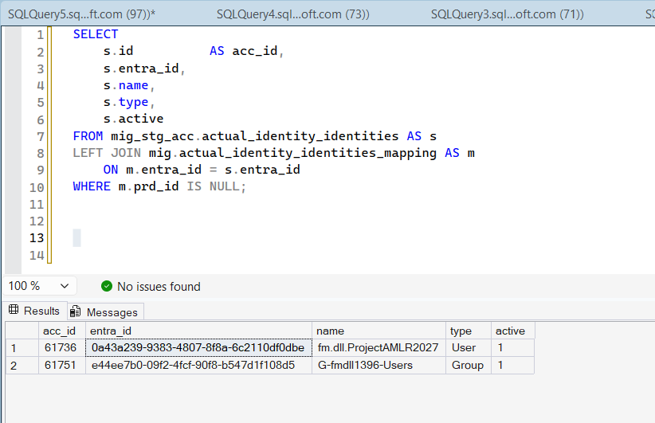
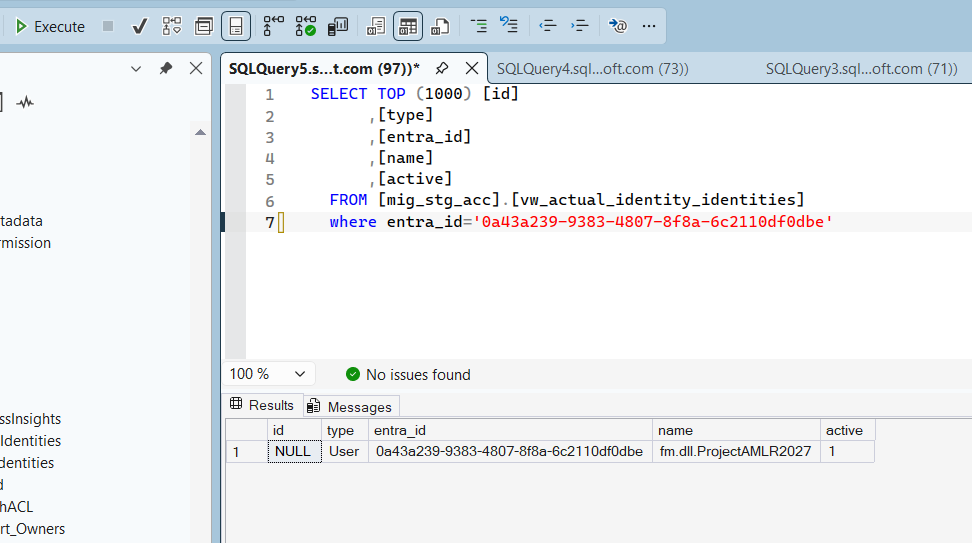
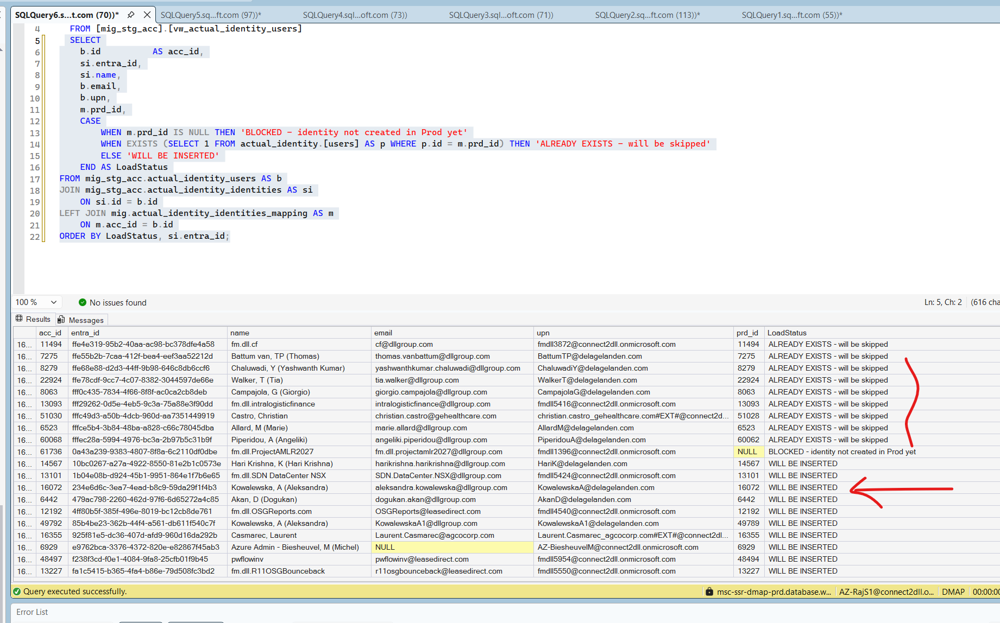
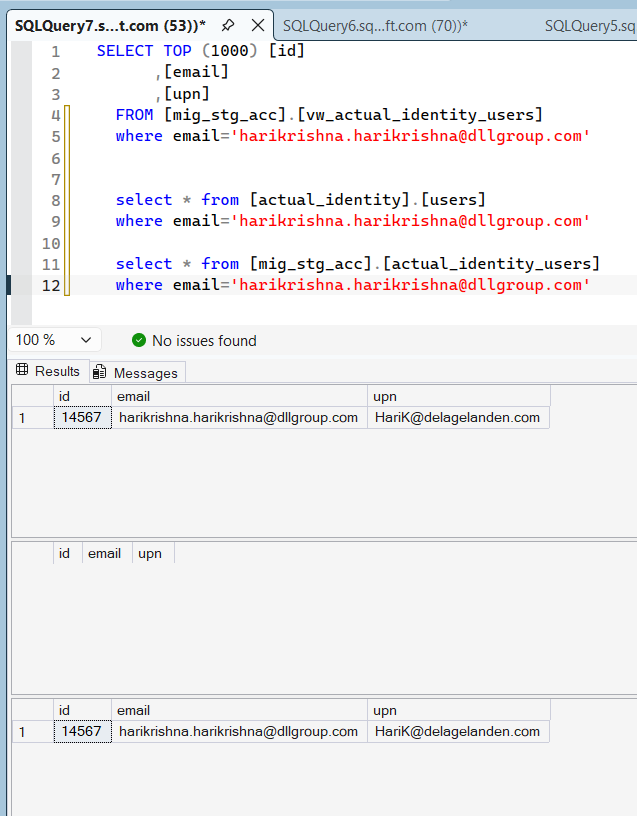
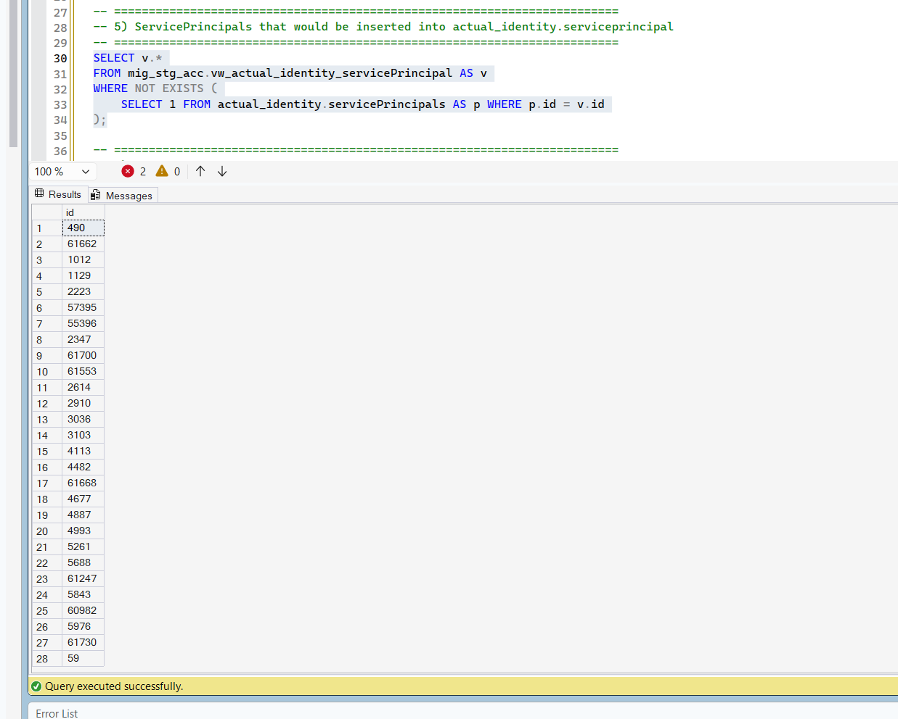
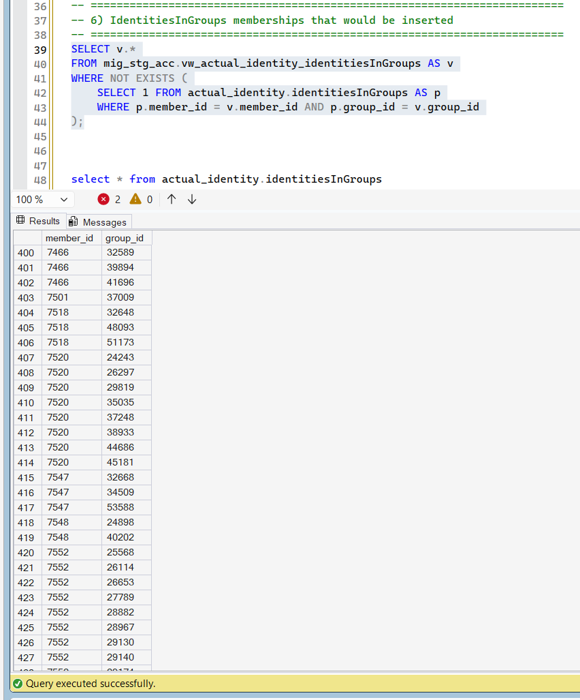
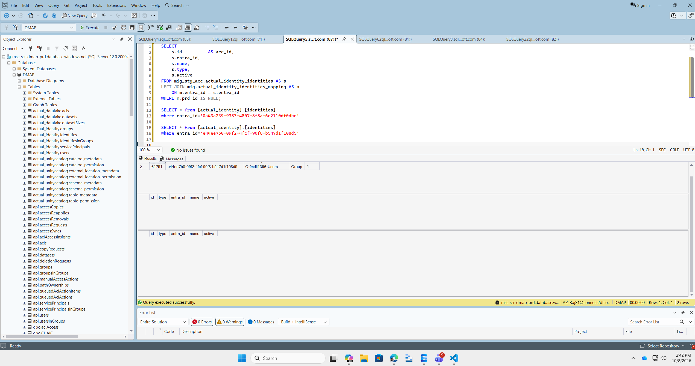
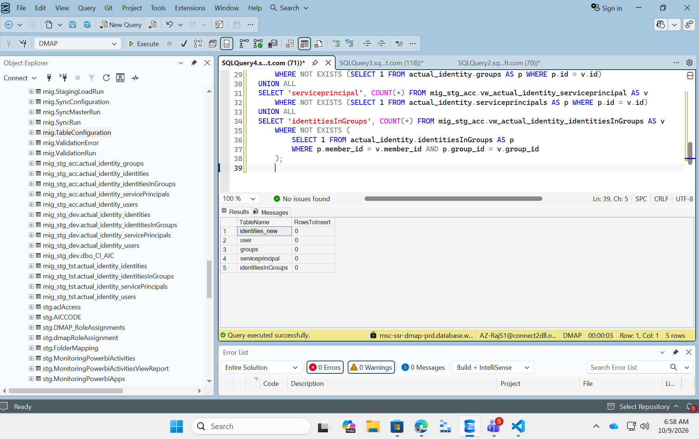
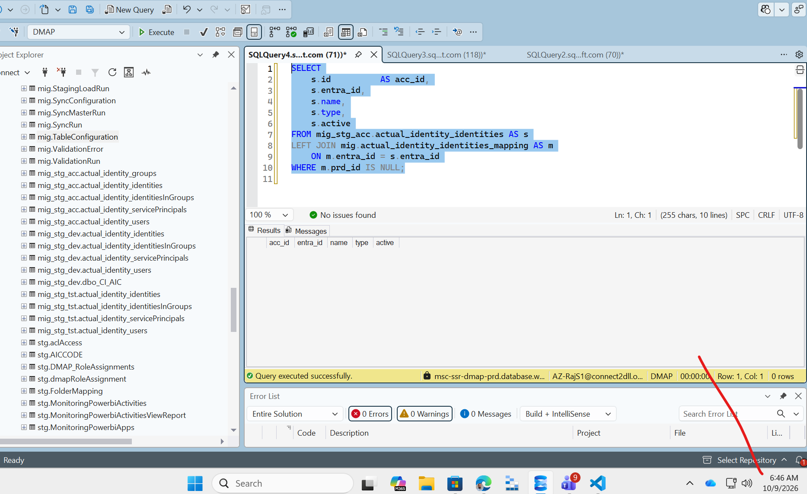

1. Check the resource ID does not exist in the Pro but exist in the lower. Make sure the refresh complted:

.\refresh-identity-mapping.ps1 -UserName "AZ-RajS1@connect2dll.onmicrosoft.com"
## Testing for IDENTITY Table

```

SELECT
    s.id          AS acc_id,
    s.entra_id,
    s.name,
    s.type,
    s.active
FROM mig_stg_acc.actual_identity_identities AS s
LEFT JOIN mig.actual_identity_identities_mapping AS m
    ON m.entra_id = s.entra_id
WHERE m.prd_id IS NULL;

```



2. If there are entry then these row needs to be inserted and in this case the View should return as Null for the Entra_id because we have mapping from the Prod:

you can get the entra_id

```

SELECT TOP (1000) [id]
      ,[type]
      ,[entra_id]
      ,[name]
      ,[active]
  FROM [mig_stg_acc].[vw_actual_identity_identities]
  where entra_id='0a43a239-9383-4807-8f8a-6c2110df0dbe'

```



## Testing for User Table


### Run the Below script to see what Users will be inserted


```

SELECT
    b.id          AS acc_id,
    si.entra_id,
    si.name,
    b.email,
    b.upn,
    m.prd_id,
    CASE
        WHEN m.prd_id IS NULL THEN 'BLOCKED - identity not created in Prod yet'
        WHEN EXISTS (SELECT 1 FROM actual_identity.[user] AS p WHERE p.id = m.prd_id) THEN 'ALREADY EXISTS - will be skipped'
        ELSE 'WILL BE INSERTED'
    END AS LoadStatus
FROM mig_stg_acc.actual_identity_users AS b
JOIN mig_stg_acc.actual_identity_identities AS si
    ON si.id = b.id
LEFT JOIN mig.actual_identity_identities_mapping AS m
    ON m.acc_id = b.id
ORDER BY LoadStatus, si.entra_id;

```



## I did small check and i see the email id is indeed missing on the prod. so load is indeed required:

```
SELECT TOP (1000) [id]
      ,[email]
      ,[upn]
  FROM [mig_stg_acc].[vw_actual_identity_users]
  where email='harikrishna.harikrishna@dllgroup.com'


  select * from [actual_identity].[users]
  where email='harikrishna.harikrishna@dllgroup.com'

  select * from [mig_stg_acc].[actual_identity_users]
  where email='harikrishna.harikrishna@dllgroup.com'

```




## Testing for groups Table: Groups that would be inserted into actual_identity.groups

```

SELECT v.*
FROM mig_stg_acc.vw_actual_identity_groups AS v
WHERE NOT EXISTS (
    SELECT 1 FROM actual_identity.groups AS p WHERE p.id = v.id
);


```


## Testing for serviceprincipal Table :  ServicePrincipals that would be inserted into actual_identity.serviceprincipal


```
SELECT v.*
FROM mig_stg_acc.vw_actual_identity_servicePrincipal AS v
WHERE NOT EXISTS (
    SELECT 1 FROM actual_identity.servicePrincipals AS p WHERE p.id = v.id
);


```



## Testing for identitiesInGroups  Table: IdentitiesInGroups memberships that would be inserted


```

SELECT v.*
FROM mig_stg_acc.vw_actual_identity_identitiesInGroups AS v
WHERE NOT EXISTS (
    SELECT 1 FROM actual_identity.identitiesInGroups AS p
    WHERE p.member_id = v.member_id AND p.group_id = v.group_id
);


```




## Successful Load: will have below Entra id inserted into the Prod Identity Table:


```

SELECT
    s.id          AS acc_id,
    s.entra_id,
    s.name,
    s.type,
    s.active
FROM mig_stg_acc.actual_identity_identities AS s
LEFT JOIN mig.actual_identity_identities_mapping AS m
    ON m.entra_id = s.entra_id
WHERE m.prd_id IS NULL;

SELECT * from [actual_identity].[identities]
where entra_id='0a43a239-9383-4807-8f8a-6c2110df0dbe'

SELECT * from [actual_identity].[identities]
where entra_id='e44ee7b0-09f2-4fcf-90f8-b547d1f108d5'

```
## Before the load




## After the load

Run below script and there should be record in the prod idenity table

```

SELECT * from [actual_identity].[identities]
where entra_id='0a43a239-9383-4807-8f8a-6c2110df0dbe'

SELECT * from [actual_identity].[identities]
where entra_id='e44ee7b0-09f2-4fcf-90f8-b547d1f108d5'


```

## Before the load ran at 9 october.




